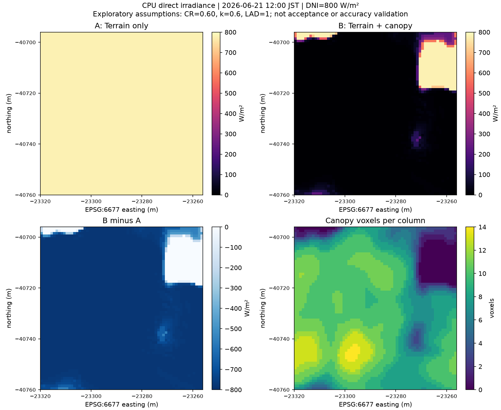

# Komae canopy shadow PoC Phase 2 — 2026-10-27

Proposed assessment: **CONDITIONAL**. Synthetic fixtures, real-data voxelization,
and A/B instantaneous CPU direct irradiance comparison succeeded. Interpretation
remains conditional because of voxel elevation/observer discretization, assumed
optical parameters, and unverified scientific source accuracy. This is neither
Standard Canopy implementation/acceptance nor scientific accuracy validation.

## Evidence and implementation identity

PR #70 was merged into main `6c211654dc3ef6320c7426bd68b5bc702cbca513` before
implementation. The real run used committed implementation
`b4a48847fe3158ef85aebbe30de7295f327cb787`, with empty `git status --short`.
The module's runtime bytes and HEAD blob both have SHA-256
`c78fe1aaf6b030d7a60c221043a43cd7eeaad31d8f4eec944035bb66ea8f43ed`.
Later report/image additions do not change that executed implementation.

Local evidence ID: `data/work/voxcity-canopy-shadow/komae-phase2-20261027-01/`.
Run completion timestamp: **2026-10-27 02:21:22.609997 JST**; runner elapsed
**15.2623562 s** (excludes test runs and later independent QA/presentation).
Historical checkout was `C:\dev\open-urban-environment-model`; absolute paths
inside local manifests identify that environment, not portable prerequisites.
Local datasets, NPZ arrays, JUnit files and full run logs are not bundled in Git.

Environment: Windows, Python 3.11.9, VoxCity 1.7.0, NumPy 2.4.6,
Rasterio 1.4.4, Numba 0.68.0, Astral 3.2, pandas 2.3.3, PyProj 3.7.2;
CPU Numba threads=4. VoxCity pin
`fa212656305328a9a657973bae26f352bfe813bc` was verified using PEP 610 VCS
origin plus all 136 installed source RECORD hashes. Aggregate source hash:
`33e2bfdbc8a677f53154e8cd16295603819c68cf9f24c7a4cdfeb196bcbcd0bd`.
This does not independently compare against the upstream Git tree.

## Input identities and provenance

All recorded upstream input hashes were checked. Existing Height Envelope
`validate_sources()` gates were reused, including acquisition/evidence bridge,
Terrain manifest and acceptance reference. SHA-256 correspondence verifies
recorded identities/declarations, not the scientific correctness of HAG or
local canopy geometry. Standard Terrain retains source-declared T.P.; there
was no independent surveying or elevation offset.

| Repository-relative local artifact | SHA-256 |
|---|---|
| `data/work/height-envelope/komae-exploratory-20261026-01/generated/height_envelope_manifest.json` | `6121cbf732f8ece9553013be2483203f08faf9a8d364136a919c184b46738d68` |
| `data/work/height-envelope/komae-exploratory-20261026-01/diagnostics/sampled_dem_z_nearest.tif` | `f456fd5a94e7f0b9a94398281d9b0db35835f4959f23fede09e143ccefe7bd33` |
| `data/work/meta_chmv2_komae_committed_audit_20261025/acquisition-record.json` | `ab83b9b466b85a4dd2a4a73749b1c2fffb68104b88f9d630ea88f2da76c956e0` |
| `data/work/meta_chmv2_komae_committed_audit_20261025/chmv2_aoi.tif` | `c5f99a4e9b21e8f419825ef2cac25ec7b36bafbe8a79a89b062201343f0ef880` |
| `data/work/height-envelope/komae-exploratory-20261026-01/inputs/source-evidence.json` | `afdf8560ac1d7a94cf599ffaa7fe17bbba29df5fca7a61df994052cdc04bf6a9` |
| `data/work/terrain-reproducibility/komae-20261026-01/generated/standard.tif` | `0afb6d1706b97bd39c8c93ff8feb580094fe585f567e2de1f2081c082602f90a` |
| `data/work/terrain-reproducibility/komae-20261026-01/generated/standard.tif.manifest.json` | `5e96bf3e0ababad7e2f79a0d2090d0356fdc707dff6115575c8b0ba8b88f5dbb` |
| `data/work/height-envelope/komae-exploratory-20261026-01/generated/canopy_top_z.tif` | `65263bb32aa846688b3fecee3e7b0893c6a9d6f2e8fa9eebaf95c0bc576aed17` |
| `data/work/height-envelope/komae-exploratory-20261026-01/generated/canopy_bottom_z.tif` | `61e82f1d8e9c1c4afc653bf6d850cc35052535fd643462da0b89403efeda158e` |
| `data/work/height-envelope/komae-exploratory-20261026-01/generated/height_envelope_state.tif` | `6a3debfbcd220d6bef9cdb736cc7d8abd545ee3156121746e019093edef71992` |

All 120,000 nearest samples of the accepted 0.5 m DEM exactly matched the
retained 1 m DEM used to generate Height Envelope. Input grid/masks, NoData,
CR=0.60 and nearest/nearest metadata were checked before cropping. All source
cells were valid; this real run does not test missing-data recovery. No filling
was performed. All existing Height Envelope run files and recorded upstream
inputs were hash-protected and unchanged after execution; independent QA
rechecked these identities again.

## Adapter and API boundary

The independent module is `src/ouem/canopy_shadow_poc.py`; no existing
Terrain, Building, Building Adapter, `komae_canopy.py`, accepted contract or
acceptance record was changed. Reproduction commands and local output contract
are in [PHASE2_USAGE.md](PHASE2_USAGE.md). Prior source investigation remains in
[API_REVIEW.md](API_REVIEW.md) and
[MINIMAL_ADAPTER_PROPOSAL.md](MINIMAL_ADAPTER_PROPOSAL.md).

The adapter subtracts the sampled DEM **once** from absolute top/bottom, then
flips rows from north-up to VoxCity south-up arrays. Zero-depth cells receive
no tree voxels experimentally; this is not a formal canopy-absence decision.
No 3 m minimum height is introduced. Buildings are absent. Both cases use
constant experimental Standard land-cover code 1 (Bareland/walkable surface).

Actual pinned APIs used:

- `voxcity.generator.voxelizer.Voxelizer.generate_combined()`;
  `_voxelize_kernel` in the same module implements rounding and ground +1.
- `voxcity.models.VoxCity`, `VoxelGrid`, `GridMetadata`, `BuildingGrid`,
  `DemGrid`, `LandCoverGrid`, `CanopyGrid` carry the common grid.
- `voxcity.simulator.solar.temporal.get_solar_positions_astral()` computes sun.
- `voxcity.simulator.solar.radiation.get_direct_solar_irradiance_map()` calls
  CPU `compute_direct_solar_irradiance_map_binary` in `solar/kernels.py` and
  `trace_ray_generic` in `simulator/common/raytracing.py`.
- `voxcity.utils.orientation.direction_to_axis_vector()` uses the recorded
  clockwise grid-north rotation; no guessed 180-degree reversal is applied.

## Experiment conditions

| Item | Actual setting |
|---|---|
| CRS / grid | EPSG:6677, 1 m, north-up outputs |
| Evaluation ROI | `[-23320,-40760,-23256,-40696]`, 64×64 cells |
| Input domain | `[-23352,-40792,-23224,-40664]`, 128×128 cells; 32 m halo |
| Cases | A terrain only; B identical terrain + Height Envelope canopy |
| Date/time | 2026-06-21 12:00 JST |
| Astral location | lon 139.57620924243287, lat 35.63262314968702 |
| True sun azimuth / elevation | 197.52081855294855° / 77.2918395863573° |
| Projected +Y true bearing | −0.14979770792591632°, used as clockwise rotation |
| Domain corner rotation range | −0.15020297144406458° to −0.14939237645254605° |
| DNI | 800 W/m², experimental constant |
| Canopy | CR=0.60; tree_k=0.6; tree_lad=1.0, assumed not observed |
| Requested observation height | 1.5 m; actual ray origin **2.001001358–3.0 m above source DEM** |
| Z origin | DEM minimum = 19.589000701904297 m |

Constant centre rotation is appropriate only as this small-domain experiment's
approximation; spatially varying convergence was not implemented.

## Geometry and fixture QA

Synthetic fixtures: **16 passed**, zero skips/errors/failures. They exercise
absolute-Z subtraction/row flip; invalid input rejection; float32 half-up
rounding, ground +1, thin-crown expansion and common-Z air padding; cardinal
sun/shadow directions using the actual CPU API; ±90° rotation sign; independent
meridian-convergence comparison; input hash failure; finite-only statistics;
night rejection; and same-Z cropped halo occupancy.

Real A/B original Z sizes were 6/28, padded to common **128×128×28** with air.
Every generated voxel matched an independent expected occupancy reconstruction;
terrain and surface classes were identical. TREE counts: **A=0, B=98,840** in
the full domain, **35,106** tree voxels across **3,842** ROI columns. No real
crown needed thin-crown expansion; that branch was covered synthetically.

The absolute face convention is `D0 + k`, centre `D0 + k + 0.5`. Ground +1
and rounding are kept as actual VoxCity behavior. Compared with source envelope,
bottom-face errors were **+0.101001740 to +1.899999619 m**, top-face errors
**+0.501001358 to +1.5 m**. Thus input subtraction and engine occupancy are
verified, but voxel faces do not exactly preserve absolute envelope heights.
No compensating offset was introduced.

The CPU observer uses the surface-transition index plus `int(1.5)`, and its ray
starts at a voxel centre. Consequently this is **not a physical 1.5 m above-DEM
irradiance assessment**: independently derived actual height is 2.001001358–3.0 m.
A/B use identical observation masks and terrain, so their numerical comparison
remains valid within these discretized conditions.

## Real CPU direct irradiance comparison

All **4,096** ROI cells were finite in both cases; masks matched. NaN was never
replaced with zero. Statistics below are instantaneous horizontal direct
irradiance, **W/m²**, not DNI, diffuse/global irradiance or annual energy.

| Statistic | A: terrain | B: terrain + canopy | B − A |
|---|---:|---:|---:|
| Minimum | 780.402577774 | 0 | −780.402577774 |
| Mean | 780.402577774 | 66.948346222 | −713.454231552 |
| Maximum | 780.402577774 | 780.402577774 | 0 |
| p5 / p25 / p50 / p75 | 780.402577774 | 0 | −780.402577774 |
| p95 | 780.402577774 | 780.402577774 | 0 |

**3,816 cells (93.1640625%) decreased; 280 were unchanged; 0 increased.**
A equals `800 × sin(solar elevation)` numerically. Independent reading of saved
arrays rechecked differences, masks, voxel occupancy and hashes. The pin's
exponential attenuation and transmission <0.01 cutoff can yield zero direct
irradiance; these zeros are computed values, not filled missing values.
The strong reduction is conditional on the assumed optical parameters and
coarse voxel representation, not a measured canopy shading benefit.



Figure: saved real-run arrays, north-up, identical ROI. A/B and difference are
W/m²; bottom-right is occupied tree voxels per vertical column. The north-east
canopy gap aligns with higher B irradiance in this computation. This is an
internal numerical pattern, not independent confirmation of real canopy
positions, heights, shadow boundaries or scientific accuracy.

## Halo and boundary diagnosis

A conservative vertical budget across the full source AOI was 28.043998718 m
(includes 2 m allowance), implying horizontal ray reach **6.324185248 m** for
this sun. With a further 2 m horizontal allowance, the 32 m halo margin is
**23.675814752 m**. This supports sufficiency for recorded source heights at
this time, not all solar angles or unknown objects outside source coverage.

A diagnostic removed all external ROI occluders by cropping the audited halo
voxel field, retaining identical D0 and inner Z indices. Unbuffered B exceeded
buffered B at **198 cells**, maximum **780.402577774 W/m²**, all within
2 cells of the ROI boundary. In the outer 8 m band (1,792 cells), mean excess
was **40.906715576 W/m²**, p95 **475.832222181 W/m²**. Interior 8 m exclusion
(2,304 cells) showed zero change. This demonstrates why the no-halo ROI would
be biased. No input-domain objects beyond the halo were added or inferred.

## Validation commands and results

```powershell
.venv\Scripts\python.exe -m pytest -q tests/test_canopy_shadow_poc.py --junitxml=data/work/voxcity-canopy-shadow/phase2-fixtures-20261027-02.xml
.venv\Scripts\python.exe -m pytest -q --junitxml=data/work/voxcity-canopy-shadow/phase2-full-pytest-20261027-01.xml
```

Focused: **16 passed in 6.23 s**. Full suite in the ordinary Windows execution
context: **542 passed, 5 skipped, 243 warnings in 167.83 s**. Five skips concern
existing Windows symlink privilege limitations (WinError 1314); warnings are
existing Rasterio/Affine pending deprecations. An initial sandbox full-suite
attempt encountered existing hard-link `os.link` access denial (WinError 5);
a diagnostic `-x` run reported 1 failed / 17 passed / 5 warnings. The full
normal-context rerun passed; this is an environment restriction distinction,
not a claim that the failed sandbox check passed. No accepted algorithms were
changed to work around that restriction.

Real CLI execution used the hashes and paths in [PHASE2_USAGE.md](PHASE2_USAGE.md),
fixture report `phase2-fixtures-20261027-02.xml` and output ID
`komae-phase2-20261027-01`. Exit code 0, `run.json` COMPLETED. A subsequent
read-only reconstruction independently confirmed full voxel occupancy, hashes,
finite masks, A baseline, monotonic differences and the observer-height range.
This is a separate computational check, not an external expert review.

## Output evidence identities

| Local output | SHA-256 |
|---|---|
| `run.json` | `e153e8da170d6dc34cfaf76bd6b1564f7924e208695e4fef75208d664bcf571d` |
| `comparison_arrays.npz` | `c5844d8fc052b60cc2d250b78221eecd5cc3e891f6e8b867e333f1790960c238` |
| `voxels_local_only.npz` | `65b9719bf31e5901c304a0010ddc2cc1f39640d604b558c25b1fd50ffd54da36` |
| `fixture-results.xml` | `1267cb895230497068a53a97a486febf2da9c39311fe16b61a0225850e2bb003` |
| Original `comparison.png` | `ee313c5b78fdad49745631dfa4f3a4db4557cd1c1d64885d9a0b2bb41e8acd9e` |
| Review PNG (committed figure) | `8d22f840efba67bba13fe773b4295475c57a023228ee1739343b19cf9e8843c1` |

The review PNG only reduces tick crowding in a new presentation from the saved
NPZ; it does not recalculate irradiance. The original image remains unchanged.
`figure-provenance.json` and `independent-verification.json` are local evidence.

## Limits and next minimum work

- Resolve the observer and canopy-face discretization interpretation before any
  physical 1.5 m pedestrian-height claim. A finer-grid sensitivity comparison
  would be a new experiment, not something completed here.
- CR=0.60, extinction coefficient and LAD are assumptions; vegetation structure,
  foliage state, local HAG error and horizontal alignment remain unverified.
- CHM imagery (2019) and DEM acquisition (2022–2023) differ in time and underlying
  ground interpretation. Source-declared T.P. is not independently surveyed.
- CHM=0/depth=0 exclusion does not establish canopy presence/absence. No polygons,
  individual trees, ecological thresholds or Standard Canopy acceptance result
  were created. Buildings were omitted; their interactions are untested here.
- Boundary sufficiency is specific to this source footprint and high sun;
  lower sun, taller external objects or larger areas need a fresh halo check.
- No diffuse/global or annual radiation, field validation, heat evaluation,
  production VoxCity integration or scientific accuracy guarantee is implied.

Independent review should first assess direction/rotation fixtures, vertical
voxel conventions and the suitability of these assumptions for a next experiment.
The technical stages succeeded; these interpretation limits keep the overall
assessment CONDITIONAL. The PR is Draft and is not merged automatically.
