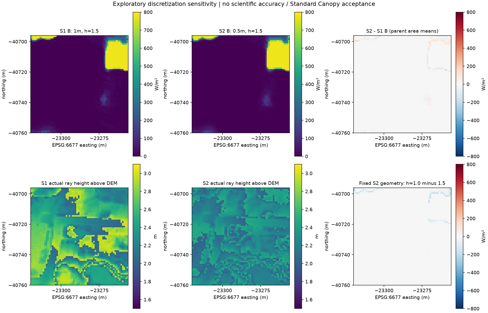

# Phase 3 — Komae vertical discretization and observer sensitivity

**Assessment: CONDITIONAL.** API review, synthetic geometry fixtures and four
real-data A/B CPU comparisons completed. S1 reproduced PR #71's arrays exactly.
0.5 m reduces measured face discretization error, but across-size irradiance
contrasts also change actual observation height and horizontal ray origins.
They do not isolate pure vertical resolution or establish scientific accuracy.
PR #71's successful exploratory calculation is not withdrawn or reinterpreted
as formal Standard Canopy acceptance.

## Scope, code and environment

PR #71 merge confirmed locally and through GitHub:
`e625e03f0dd2b826e03380f941edca4aa2126199`. New isolated implementation and tests
leave Phase 2, accepted Standard/Building Adapter, input datasets and acceptance
records unchanged. Review method, formulas and commands in
[PHASE3_API_AND_METHOD.md](PHASE3_API_AND_METHOD.md); Phase 2 baseline remains
[PHASE2_RESULTS_20261027.md](PHASE2_RESULTS_20261027.md).

Actual execution: **2026-10-27 09:49:23.885237 JST** (completion), local evidence
ID `data/work/voxcity-canopy-shadow/komae-phase3-20261027-01/`.
Executed Git HEAD `99a39b6a63213587a04c1095f2f4dfddd3737da7`, clean worktree.
Phase 3 module SHA-256:
`a675987a79ea974e794bcf628ac85d765d8cb8438732543c6b7e0edd1b1c7735`.
The runtime bytes were checked against that commit. Later report/image commits
do not change executed code. Local source snapshots, fixture/full JUnit,
independent verification and frozen implementation copies are retained in the
run, not committed. Historical checkout `C:\dev\open-urban-environment-model`
is an environment identity; repository-relative paths below are preferred.

Windows OUEM venv: Python 3.11.9, VoxCity 1.7.0, NumPy 2.4.6, Numba 0.68.0,
Rasterio 1.4.4, PyProj 3.7.2, Astral 3.2, pandas 2.3.3, CPU threads=4.
VoxCity commit `fa212656305328a9a657973bae26f352bfe813bc` verified through
PEP 610 origin plus all 136 installed Python source RECORD hashes; aggregate
`33e2bfdbc8a677f53154e8cd16295603819c68cf9f24c7a4cdfeb196bcbcd0bd`.
This does not independently compare the upstream Git tree. No VoxCity patch,
non-public API modification or dependency change was made.

## Phase 3A — supported geometry boundary

The inspected public APIs have a single scalar isotropic mesh size. Horizontal
1 m / vertical 0.5 m anisotropy is not supported by this route. Public
`Voxelizer.generate_combined()` and `get_direct_solar_irradiance_map()` safely
accepted 0.5 m isotropic grids after critical fixture gates passed.

Each 1 m source DEM and canopy cell was replicated into 2×2 aligned 0.5 m
children, preserving the original Height Envelope absolute top/bottom values
and its nearest DEM. Relative heights subtract that DEM once. No new detail
was sampled from canonical Terrain, no interpolation or NoData filling was
performed, and no new canopy information was inferred. The canonical accepted
0.5 m Terrain file remains unchanged.

The evaluated 64×64 m ROI and 32 m halo domain match Phase 2:
`[-23320,-40760,-23256,-40696]` and
`[-23352,-40792,-23224,-40664]` (EPSG:6677). S1 uses 64×64 native ROI samples;
S2 uses 128×128. Four equal-area S2 children are averaged into each 1 m parent
for irradiance comparisons. All were finite. Samples are not falsely treated
as additional independent source observations.

Ground +1 adds one voxel size. DEM and relative crown heights are separately
rounded; thin crowns can be expanded. CPU height parameter becomes
`int(h/s)` and the tracer adds a half-voxel centre. Actual absolute ray Z is
`D0 + (g + int(h/s) + 0.5)*s`, where
`g = int(float32(D-D0)/s + 0.5) + 1`. Source DEM minimum D0 is
19.589000701904297 m in both sizes. No offset adjustment is applied.

On flat ground, h=1.5 yields ray heights 2.5 m (1 m voxels) and 2.25 m
(0.5 m voxels). At 1 m size h in [0,1) can give exact 1.5 m on flat ground;
at 0.5 m size no nonnegative scalar parameter gives exact 1.5 m there.
On rough DEM neither common parameter assures exact 1.5 m everywhere.
The ground-map API lacks per-cell explicit origins. Building-face solar APIs
have different mesh/normal/SVF semantics and were not repurposed as sensors.

## Phase 3B — synthetic fixtures and regression

Before real-data execution, focused tests reported **36 passed in 6.32 s**
(20 new Phase 3 cases + 16 existing Phase 2 cases; no skips/failures/errors).
Fixtures cover known absolute box faces/volume; size-dependent +1 and rounding;
thin crown expansion; actual ray Z confirmed by analytic zenith attenuation
through the public CPU map API; cardinal sun/opposite shadows at both sizes;
A/B observation mask equality; observation-index bins; one-metre parity with
Phase 2; parent/child area identity; invalid aggregation; and cropped halo
metadata/occupancy preservation. In flat-box fixtures, face errors equal s;
known 3 m³ crown volume is retained at both sizes.

Final full regression in ordinary Windows execution context:
**562 passed, 5 skipped, 243 warnings in 166.76 s**. Skips concern existing
Windows symlink privileges; warnings are existing Rasterio/Affine pending
deprecations. No accepted code was changed. An earlier full run was deliberately
interrupted while completing the size-preserving halo wrapper; it is not a
completed test result. The final full run and focused report apply to executed
implementation. Code was committed before real processing.

```powershell
.venv\Scripts\python.exe -m pytest -q tests/test_canopy_shadow_sensitivity.py tests/test_canopy_shadow_poc.py --junitxml=data/work/voxcity-canopy-shadow/phase3-fixtures-20261027-02.xml
.venv\Scripts\python.exe -m pytest -q --junitxml=data/work/voxcity-canopy-shadow/phase3-full-pytest-20261027-02.xml
```

## Input identities and invariance

The Phase 2 loaders rechecked acquisition, evidence bridge, accepted Terrain,
full 120,000 nearest DEM reference samples, raster metadata/masks and upstream
hashes. Phase 2 `run.json` is pinned to
`e153e8da170d6dc34cfaf76bd6b1564f7924e208695e4fef75208d664bcf571d`.
All Phase 2 output identities and both prior local runs were protected.
Post-run checks and separate read-only reconstruction verified identities again.
These checks establish recorded provenance, not scientific HAG/DEM equivalence.

| Local input | SHA-256 |
|---|---|
| `data/work/height-envelope/komae-exploratory-20261026-01/generated/height_envelope_manifest.json` | `6121cbf732f8ece9553013be2483203f08faf9a8d364136a919c184b46738d68` |
| `data/work/height-envelope/komae-exploratory-20261026-01/diagnostics/sampled_dem_z_nearest.tif` | `f456fd5a94e7f0b9a94398281d9b0db35835f4959f23fede09e143ccefe7bd33` |
| `data/work/meta_chmv2_komae_committed_audit_20261025/chmv2_aoi.tif` | `c5f99a4e9b21e8f419825ef2cac25ec7b36bafbe8a79a89b062201343f0ef880` |
| `data/work/height-envelope/komae-exploratory-20261026-01/inputs/source-evidence.json` | `afdf8560ac1d7a94cf599ffaa7fe17bbba29df5fca7a61df994052cdc04bf6a9` |
| `data/work/terrain-reproducibility/komae-20261026-01/generated/standard.tif` | `0afb6d1706b97bd39c8c93ff8feb580094fe585f567e2de1f2081c082602f90a` |
| `data/work/height-envelope/komae-exploratory-20261026-01/generated/canopy_top_z.tif` | `65263bb32aa846688b3fecee3e7b0893c6a9d6f2e8fa9eebaf95c0bc576aed17` |
| `data/work/height-envelope/komae-exploratory-20261026-01/generated/canopy_bottom_z.tif` | `61e82f1d8e9c1c4afc653bf6d850cc35052535fd643462da0b89403efeda158e` |
| `data/work/height-envelope/komae-exploratory-20261026-01/generated/height_envelope_state.tif` | `6a3debfbcd220d6bef9cdb736cc7d8abd545ee3156121746e019093edef71992` |

CHM imagery (2019) versus DEM acquisition (2022–2023), local HAG error,
horizontal accuracy, ground interpretation and source-declared T.P. limitations
remain unchanged. Constant CR=0.60, k=0.6, LAD=1.0 and canopy-presence assumptions
are experimental. Depth=0 cells are excluded from voxel trees, not declared
confirmed canopy absence. No buildings are included.

## Phase 3C — four actual comparisons

All cases: 2026-06-21 12:00 JST, DNI=800 W/m², Astral azimuth
197.52081855294855°, elevation 77.2918395863573°,
clockwise grid-north rotation −0.14979770792591632°. Both A/B share DEM,
walkable Bareland label, size and all optical/solar parameters. All native
observation masks match; A TREE=0 and B TREE>0 in every case.
A mean is **780.402577774 W/m²** in all cases. No NaN is replaced with zero.

| Case | Isotropic size m | API height m | Actual ray height above DEM min–max m | Actual mean m | B mean W/m² | B−A mean W/m² | Decreased 1m parent cells /4096 |
|---|---:|---:|---|---:|---:|---:|---:|
| S1 | 1.0 | 1.5 | 2.001001–3.000000 | 2.499195 | 66.948346 | -713.454232 | 3816 |
| S1_low | 1.0 | 0.5 | 1.001001–2.000000 | 1.499195 | 62.689234 | -717.713344 | 3854 |
| S2 | 0.5 | 1.5 | 2.001001–2.500000 | 2.251514 | 67.393720 | -713.008858 | 3827 |
| S2_low | 0.5 | 1.0 | 1.501001–2.000000 | 1.751514 | 64.830637 | -715.571941 | 3831 |

All four comparisons have **zero B>A cells**. S1 A and B arrays equal the
PR #71 saved baseline exactly, not just within rounded statistics. Face error
statistics below use positive-thickness occupied ROI columns (S1 3,842 / S2
15,368 children), rather than the full halo-domain ranges in Phase 2's report.
Positive error means a voxel face is above the original absolute envelope.
No real ROI thin crowns required expansion; fixtures exercised that branch.

| Case / face | Min m | p5 m | Median m | p95 m | Max m | Mean m |
|---|---:|---:|---:|---:|---:|---:|
| S1 bottom | 0.104002 | 0.325051 | 0.997001 | 1.660951 | 1.900000 | 0.996637 |
| S1 top | 0.501001 | 0.556000 | 0.980999 | 1.453999 | 1.500000 | 1.001790 |
| S2 bottom | 0.051001 | 0.172001 | 0.517001 | 0.868002 | 0.949001 | 0.518370 |
| S2 top | 0.251003 | 0.278000 | 0.489002 | 0.722000 | 0.750000 | 0.499057 |

The finer lattice approximately halves face bias in this dataset, without
removing the +1 rule. This is a numerical geometry observation, not evidence
that finer output equals more accurate real crowns. S1_low and S2_low retain
exactly the same geometry as S1 and S2 respectively.

| Case | Actual absolute ray Z range m (source-declared T.P. context) | Ray height p5 m | Median m | p95 m |
|---|---|---:|---:|---:|
| S1 | 22.089001–26.089001 | 2.058001 | 2.481001 | 2.953001 |
| S1_low | 21.089001–25.089001 | 1.058001 | 1.481001 | 1.953001 |
| S2 | 21.839001–26.339001 | 2.029001 | 2.244001 | 2.473001 |
| S2_low | 21.339001–25.839001 | 1.529001 | 1.744001 | 1.973001 |

These Z coordinates identify model ray origins, not independently surveyed
points. S1_low is near the target 1.5 m on average but spans about 1–2 m;
it must not be described as uniformly exact 1.5 m.

| Size | ROI TREE count | ROI occupied volume m³ | Halo-domain TREE count | Domain occupied volume m³ |
|---|---:|---:|---:|---:|
| S1 | 35,106 | 35,106.0 | 98,840 | 98,840.0 |
| S2 | 280,096 | 35,012.0 | 788,764 | 98,595.5 |

Counts cannot be compared as equal-volume samples: voxel volumes are 1 and
0.125 m³. The ROI volume difference is −94.0 m³ (approximately −0.268%).
These are occupied model volumes, not accepted biological crown volumes.

## Sensitivity and separation of effects

All contrasts below use 4,096 equal-area 1 m parents; units W/m².
Since A is identical, B contrasts also equal differences in the A/B reductions.

| B contrast | Mean | Min | Max | Mean absolute | RMSE |
|---|---:|---:|---:|---:|---:|
| S2_minus_S1_b | 0.445374 | -168.120390 | 222.380012 | 3.401333 | 14.682133 |
| S1_low_minus_S1_b | -4.259113 | -473.044071 | 168.206496 | 6.006624 | 33.327751 |
| S2_low_minus_S2_b | -2.563083 | -246.511278 | 35.423608 | 2.961379 | 18.216411 |
| S2_low_minus_S1_low_b | 2.141404 | -241.599783 | 276.586343 | 5.462474 | 25.520814 |

For primary S2−S1, p5/median/p95 are **−5.604800136 / 0 / 6.370556009 W/m²**.
375 parents increase, 355 decrease, 3,366 are numerically near zero
(|difference|≤1e−9 W/m², a numerical count tolerance, not a shading criterion).
The small mean +0.445374 W/m² hides local changes up to −168.120390 / +222.380012.

Within each size, only h changes on the same voxel geometry and horizontal
sample positions; actual ray Z lowers exactly 1 m (S1_low) or 0.5 m (S2_low).
The corresponding B means change by −4.259113 and −2.563083 W/m². Individual
cells can brighten when the ray begins lower because they follow different
paths through finite crowns/shadow boundaries. There is no monotonic-with-height
requirement. These cross-height increases are distinct from adding-canopy B>A,
which did not occur.

Across sizes, ground/crown rounding, finite horizontal ray-origin sampling and
actual origin Z change together. With common D0, the 1 m centre Z lattice and
0.5 m centre Z lattice are disjoint. Thus exact matched-origin comparison is
not available in this map API; observed S2−S1 remains a **composite sensitivity**,
not a pure vertical-resolution effect. Same-size tests isolate observer-index
sensitivity but do not uniquely apportion the cross-size contrast.



Figure: actual saved CPU arrays, north-up EPSG:6677, unchanged 64×64m ROI.
Top panels use 1m parent irradiance means; bottom actual-height panels preserve
native spatial samples. A/B and sensitivity are model results, not field
validation or Standard Canopy acceptance.

## Time and memory

| Size | Common A/B shape | A+B voxel array bytes | RSS start MiB | Sampled max RSS MiB | Build+geometry audit s | Main A/B solar s | Size window incl. both heights/audits/halo s |
|---|---|---:|---:|---:|---:|---:|---:|
| S1 | 128×128×28 | 917,504 | 288.414 | 325.758 | 1.089609 | 0.036249 | 1.144298 |
| S2 | 256×256×54 | 7,077,888 | 325.738 | 358.562 | 0.473231 | 0.015517 | 0.589881 |

S1_low solar pair: 0.0027173 s; S2_low: 0.0161754 s. Each size window builds
once and evaluates two heights plus two no-halo diagnostics. RSS is sampled
whole-process working set at nominal 10 ms; includes interpreter, libraries,
JIT, retained arrays and allocator behavior. S1 ran first; S2 reused compiled
kernels/libraries. This single ordered run is **not** a controlled speed or
peak-allocation benchmark. Reported size-window times exclude initial input
verification/imports and final plotting; they are not total CLI elapsed time.
Exact A+B voxel storage grows from 0.875 to 6.75 MiB.

## Halo and boundary QA

Both sizes retain the same 32 m physical halo. Conservative full-source
height budget +2 m gives reach **6.324185248 m** under this high sun; including
2 m horizontal allowance leaves **23.675814752 m** margin. The maximum measured
face shift is below the 2 m vertical allowance. This only covers recorded
source heights/extent and the selected sun, not unknown exterior occluders.

The no-halo diagnostic crops audited voxels with identical D0/Z indices;
Phase 3 explicitly preserves 0.5 m metadata, leaving Phase 2 unchanged.
Affected native cells: S1=198, S1_low=223, S2=772, S2_low=785. The S2 counts
are quarter-area cells and cannot be compared directly as areas with S1.
Maximum excess unbuffered irradiance is 780.402577774 W/m²; all four cases
show **zero changes in the interior after excluding an 8 m edge band**.
Thus halo removal demonstrably biases edges; retaining the halo is justified
for this conditional experiment. No new boundary objects were invented.

## Saved evidence and reproducibility

Local `run.json` COMPLETED was followed by a separate read-only reconstruction
(`independent_verify.py`, `independent-verification.json`), which checked all
hashes, executed code identity, analytic ROI occupancy/faces/ray Z, parent-area
means, A baseline, mask equality, contrasts and fixed-geometry height shifts.
This is independent computational reconstruction, not an external expert audit.

| Output | SHA-256 |
|---|---|
| `run.json` | `5ffea2f0aaad4a005bd8eaa768371aff3b2056bd73b6ea14918df7d6597fadcd` |
| `sensitivity_arrays.npz` | `88f8e6547cbd0616adc5b37bf6d118ba86e0501a52db20629492be416c6cc650` |
| `sensitivity.png` / committed figure | `a098cfbbb68745ad363f0ef9fd2bbd546c589c942cd5e6a12245dfe82a788d31` |
| `fixtures.xml` | `2d83790ecc6457d7a46a1628a646a6096e704ada0d5642ab9c01e3bb7351acdd` |

Reproduction requires the private/local input evidence packet and previous
Phase 2 run, not merely this Git checkout. Use the method document's command
with a new output directory; do not overwrite original runs or accepted data.
Only reusable implementation/tests, method/results summaries and one small
figure are submitted. No TIFF, NPZ, full local run, source snapshots or one-off
verification scripts are committed.

## Next minimum work and limits

1. Independent review should choose a physical observer definition, including
   whether exact per-cell origins require a separately validated public API
   pathway; do not silently compensate accepted geometry or patch VoxCity.
2. Any later separation of pure geometry versus sampling effects needs matched
   physical ray origins and a defined horizontal quadrature. Current cases
   cannot establish it; neither size is declared the scientifically correct one.
3. Optical/CR sensitivity, lower solar elevations/halo, field alignment/height
   checks and buildings are later experiments. Diffuse/global/annual radiation
   and thermal comfort were not calculated.

All executed technical checks succeeded; unresolved geometric interpretation
keeps the final assessment **CONDITIONAL**. This quantifies PR #71's limits
without changing its existing result, formal contracts or acceptance status.
