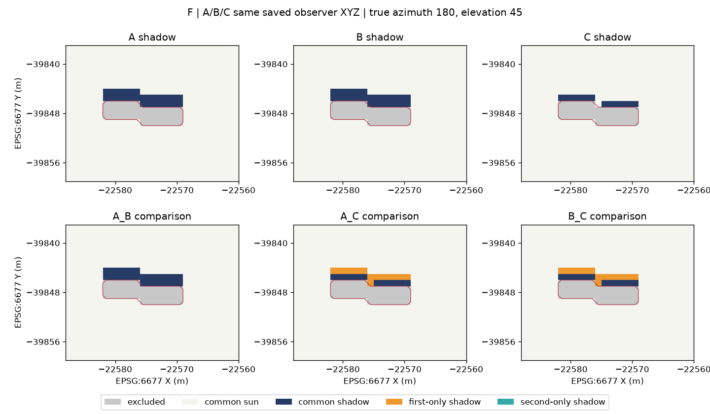
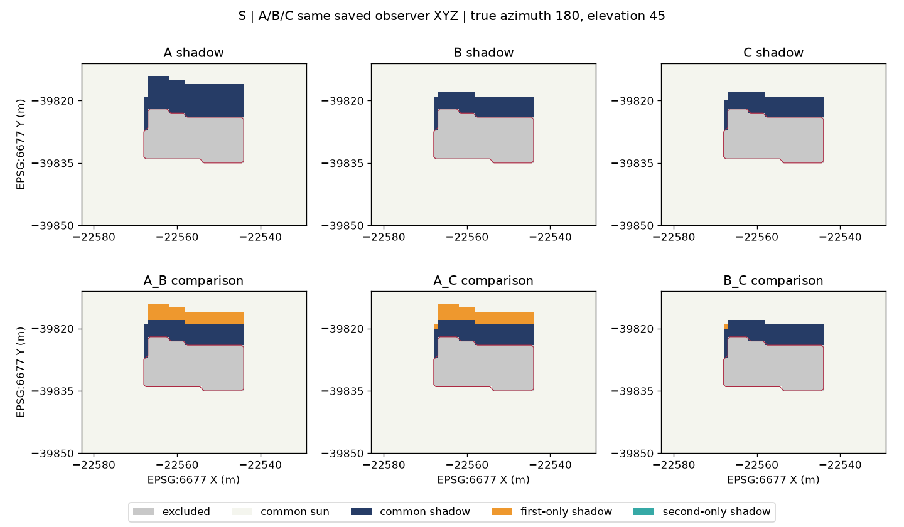
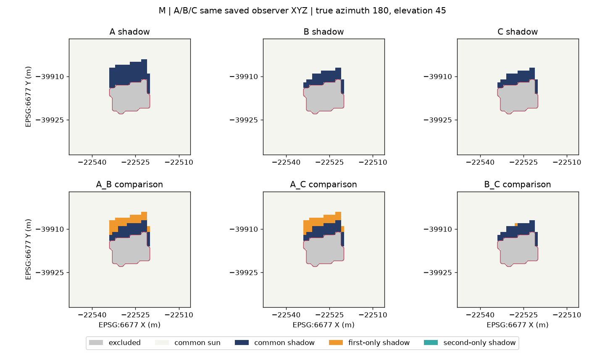
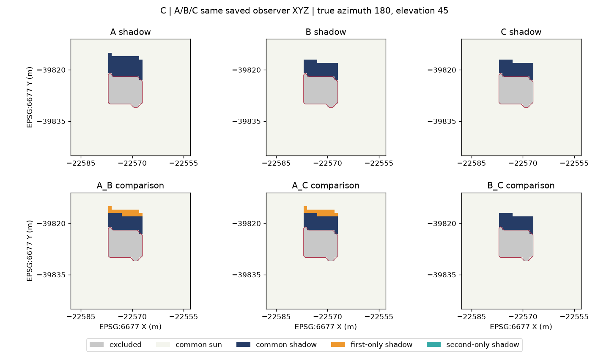

# P1-2b — 同一観測点・太陽・ray核によるA/B/C日陰比較

2026-11-09。基点main `596d1ed758a7d06c68497dff94b389d79a821195`。
**作業開始前にPR #174のmerge commitとmainへの包含を確認した。**
[P1-2a仕様](../p1-2a/P1-2a_EXPERIMENT_SPEC_DRAFT.md)に基づく1m限定の実験である。

## 結果

**F/S/M/CすべてでGate 1〜5を通過した。**
保存A/Bの全valid点で分類を完全再現した後にCを生成し、同じXYZ・direction・既存ray核で比較できた。
今回のC起点占有による除外は全棟0点で、共通maskは保存A/Bのmaskと一致した。

| 建物 | 共通valid点 | A日陰 m²/セル | B日陰 m²/セル | C日陰 m²/セル | C−B | B/C変化セル | B/C日陰IoU |
|---|---:|---:|---:|---:|---:|---:|---:|
| F | 577 | 26 | 26 | 12 | −14 | 14 | 0.461538 |
| S | 1845 | 192 | 118 | 117 | −1 | 1 | 0.991525 |
| M | 1558 | 98 | 53 | 52 | −1 | 1 | 0.981132 |
| C | 1108 | 60 | 44 | 44 | 0 | 0 | 1.000000 |

FではA=BだがCとは異なる。S/MはBとCの差が各1セル、C棟では同一分類だった。
全ペアで今回観測された変化は第一モデルの日陰→第二モデルの日向であり、逆方向は0。
逆方向の変化を禁止した結果ではない。両方向を許す既存の差分集計を使用し、増加を含む合成fixtureも検証した。
これは離散1m²観測セルに帰属する面積で、連続した実際の日陰面積ではない。contextが重なる4棟の面積を市域unionとして合計しない。

| Gate | 最終判定 | 実施内容 |
|---|---|---|
| 1 | **PASS** | F/S/M/Cの全5,088保存valid点×A/B＝10,176評価で不一致0。起点XYZも完全一致 |
| 2 | **PASS** | 全control通過後に4棟の保存merge-only meshから共通D0-grid Cを生成。補修/容量/原H/voxel境界QA成立 |
| 3 | **PASS** | C日陰前に4棟のM・除外理由・位置・SHAを保存。C起点占有除外0、範囲/容量外0 |
| 4 | **PASS** | 同じM上の3ペア、分類/面積/IoU/両方向差分を保存。外周二セル無日陰、上部3 AIR追加で不変 |
| 5 | **PASS（独立比較で確定）** | 独立2runのmanifestと全101出力SHA一致。保存再読込・入力/環境不変を確認 |

Technical executionはPASS、次工程は**CONDITIONAL_REVIEW_REQUIRED**。
`scientific_validation=NOT_VERIFIED`、`formal_acceptance=NOT_VERIFIED`、`terrain_integration_ready=false`。
Cをground truth、または今回の結果を現地日陰精度の認証とは呼ばない。

## 固定入力と処理順序

Aは保存cell_max Hの最大値を建物全列に与える代表上端、Bはセル別cell_max H、Cは保存LoD2 solid由来のvoxelである。
baselineは[STEP 4-C](../../height_distribution/STEP4C_REAL_LOD2_SHADOW_COMPARISON.md)の保存manifest
`82488e2807a0cbc95cb528d25a38bc77a2e4a1c3181122a091f75c2ec7eb7c8e`と全125 output SHAから同定した。
保存report SHAは`c84599fdca7b20828702b314d1e1a863695567b30e3d670fcd23fddca4a4227e`。
Run名だけで採用していない。

Cの元meshは公開P1-1a/P1-1b manifestが固定したローカルmanifestと元三角形/merge配列のSHAを要求した。
さらに元CityGML member、Standard、STEP 4-0 reportを固定SHAで読み、ID/LoD2/全polygon・ring・三角形/絶対Hを再照合した。
各建物のsource_id/ouem_idは従来のF/S/M/Cから変更していない。全263面、318三角形の対応を維持している。
すべての入力・実装・エンジンソース・出力の対応は[manifest](manifest.json)に記録した。
公開の元記録は[P1-1a](../p1-1a/P1-1a_REPORT.md)、[P1-1b](../p1-1b/P1-1b_REPORT.md)、[P1-1c](../p1-1c/P1-1c_REPORT.md)、
[P1-2a読取証拠](../p1-2a/input_alignment_evidence.json)を参照。

runnerは**8本のA/B full-mask controlが全部PASSするまで、実Cの読み込み・生成・ray評価へ進まない**。
続いて全4棟のC voxel QA、全4棟のgeometry-only mask保存を順に完了し、それから初めてCの日陰を評価する。
Gate中の例外は当該GateをBLOCKED、後続をNOT_EXECUTEDとし、失敗を完成扱いにしない。
Gate 1不一致があればC関数に到達しないことも独立テストで確認した。

## Gate 1 — A/B再現control

保存voxel、valid/index/XYZ、D0、contextとdirectionを読み取り専用で使用した。
整数ray起点は`(R−1−r, c, k_saved)`、voxelはaxis 0を一度反転する。
ray核の`+0.5`を含めて世界座標へ戻し、全保存valid点でXYZの**完全一致**を要求した。微小移動・floorによる起点代替はない。
無効点は保存どおりindex=-1、XYZ=NaN、分類255。valid maskが保存分類の有効範囲と異なればcontrolを拒否し、縮小して不一致を隠せない。

使用核は固定VoxCityの`voxcity.simulator.common.raytracing.trace_ray_generic`。
Pythonの明示点loopから既存DDAを呼び、新しいrayアルゴリズムは実装していない。
既存binary map kernelと同じ事前direction正規化を再現し、ray核自身の正規化もそのまま使用した。
設定は`hit_values=(0,-1,1)`、`inclusion_mode=False`、meshsize=1m、tree_k=.6/tree_lad=1（TREEなしで非作動）。
GROUND/SURFACEは透過、BUILDING=-3だけが遮蔽する。roof observerは保存maskによって除外されたままである。

真方位180°・高度45°、単棟contextごとの保存bearing/directionを完全値で使った。
kernelのnorth/east/upで約`[-0.7071,-0.00179,+0.7071]`、観測点→南の太陽へのrayであり、影は投影北・少し東に延びる。
requested height 0mは旧binary conventionで、保存observerの数値上の実効地盤高との差は約1〜2m。1.5mへ変更していない。

| 建物 | 保存valid点 | A不一致 | B不一致 | 保存A/B日陰数の再現 |
|---|---:|---:|---:|---|
| F | 577 | 0 | 0 | 26 / 26 |
| S | 1845 | 0 | 0 | 192 / 118 |
| M | 1558 | 0 | 0 | 98 / 53 |
| C | 1108 | 0 | 0 | 60 / 44 |

保存STEP 4-CのNumba 0.68.0と独立P1の0.68.1の差は維持し、依存を変更せずcontrolで再現性を確認した。
このデータ・条件で一致したという結果であり、両Numba版の一般的同値性を主張しない。

## Gate 2 — C-derived共通格子と境界

保存merge-only配列を実際のvoxel入力に使用し、VoxCityGMLのprivate低位API
`_voxelize_building_solid`とP1-1cの`traced_voxelize`を再利用した。
無MeshLib経路をmergeへ限定し、補修結果は保存mergeと配列一致、内部の三角形座標も向き/順序を除く**丸めなしの完全一致**を要求した。
実traceは4棟とも`repair:merge`→`occupancy:True`。trimesh repair・穴埋め・voxel marching・hull・sealed-surface fallbackは発生していない。
既知のimport警告文に「voxel→hull」と表示されても、実traceと混同していない。

context XYは保存STEP 4-Cと同じ、north-up、1m。CにGROUND/SURFACEやDEMを作っていない。
初期0はAIRクラスであり、標高0の代替DEMではない。
D0は格子の座標原点で、元meshのHを引き下げたりDEMへ再アンカーしたりしていない。
旧P1-1cのmin_z=23m格子を再ラベル/整数padしたものでもない。

Nzは仕様どおり`max(Nz_AB, ceil(max(mesh_Hmax, observer_Hmax)−D0)+2)`。
元mesh下端がD0以上、上端と全保存observerが容量内であることを検証した。
A/Bは新規メモリ配列へ上部AIRだけを追加し、元の全層・GROUND/SURFACEは完全保持。追加後も全保存valid点controlが一致した。

| 建物 | context [xmin,ymin,xmax,ymax] | D0 m | C shape(R,C,Nz) | C占有セル | C上端のさらに上のAIR層 |
|---|---|---:|---|---:|---:|
| F | [-22588,-39859,-22560,-39837] | 24.485000610351562 | (22,28,5) | 117 | 2 |
| S | [-22583,-39850,-22529,-39811] | 24.55299949645996 | (39,54,12) | 2155 | 2 |
| M | [-22548,-39937,-22506,-39897] | 24.336999893188477 | (40,42,11) | 852 | 2 |
| C | [-22588,-39845,-22553,-39811] | 24.51799964904785 | (34,35,10) | 576 | 2 |

全方向1セルの同位相padding検査でcore完全一致・追加領域の占有0。
C占有bboxと最大上端/最低observerから保守的な影到達枠を求め、既存contextの一セル内側へ収まることを確認した。
実際の外周二セル無日陰と上部3 AIR追加の分類不変はGate 4で確認した。
周辺実建物を追加せず、旧contextを広げた結果との比較へ切り替えていない。

## Gate 3 — 共通maskと除外

C日陰前に`M=M_AB ∩ M_C_air`を4棟とも確定し、mask NPYのファイルSHA・配列SHA、除外理由map、占有除外位置/XYZを保存した。
範囲外・容量外は除外理由へ混ぜずBLOCKEDとする。起点を移動せず、C占有を日向/日陰へ置き換えない。

| 建物 | 元M_AB | 共通M | 元A/B建物除外列 | C起点占有の追加除外 | 範囲/容量外 |
|---|---:|---:|---:|---:|---:|
| F | 577 | 577 | 39 | 0 | 0 |
| S | 1845 | 1845 | 261 | 0 | 0 |
| M | 1558 | 1558 | 122 | 0 | 0 |
| C | 1108 | 1108 | 82 | 0 | 0 |

理由コードは0=元A/B除外、1=共通AIR点、2=C起点占有。追加除外位置/XYZの集合は全棟空だった。
今回M=M_ABだったが、一般に同じになるとは仮定していない。今後除外が生じれば選択効果自体を報告する必要がある。

## Gate 4 — 同一Mでの比較と解釈

モデル別日陰割合はFのA/B/C=4.5061%/4.5061%/2.0797%、S=10.4065%/6.3957%/6.3415%、
M=6.2901%/3.4018%/3.3376%、C棟=5.4152%/3.9711%/3.9711%。
元STEP 4-Cの全域A/B統計を別フィールドで保持し、共通M上の再集計を別フィールドにした。今回はMが同じなので数値も一致した。

| 建物 | ペア | 第二−第一の日陰面積 m² | 変化セル | 第一のみ日陰 / 第二のみ日陰 | IoU |
|---|---|---:|---:|---:|---:|
| F | A/B | 0 | 0 | 0 / 0 | 1.000000 |
| F | A/C | −14 | 14 | 14 / 0 | 0.461538 |
| F | B/C | −14 | 14 | 14 / 0 | 0.461538 |
| S | A/B | −74 | 74 | 74 / 0 | 0.614583 |
| S | A/C | −75 | 75 | 75 / 0 | 0.609375 |
| S | B/C | −1 | 1 | 1 / 0 | 0.991525 |
| M | A/B | −45 | 45 | 45 / 0 | 0.540816 |
| M | A/C | −46 | 46 | 46 / 0 | 0.530612 |
| M | B/C | −1 | 1 | 1 / 0 | 0.981132 |
| C | A/B | −16 | 16 | 16 / 0 | 0.733333 |
| C | A/C | −16 | 16 | 16 / 0 | 0.733333 |
| C | B/C | 0 | 0 | 0 / 0 | 1.000000 |

共通日陰/日向数、両方向の遷移、空union flagも[results.json](results.json)に保存した。
差分mapは0除外/1共通日向/2共通日陰/3第一のみ日陰/4第二のみ日陰。
shadowは0日陰/1日向/255除外。空unionならIoU=1とし非情報的な値と明示する実装だが、今回空unionはなかった。

**Fの差を屋根形状の精度差とは解釈しない。** 元の平屋根上端Hは同じ27.0858mだが、A/Bの最高建物voxel上面は28.485000610m、Cは27.485000610m。
同じ原Hからでも、2.5Dの地盤/地表面層・押出しと、閉じたLoD2 solidのcontact-shell充填では量子化が異なる。
この1mの上面差はFで短いCの日陰となる主要な数値的説明であり、原H変更やray kernelの版差が発生したことを意味しない。
S/MのB/C差はそれぞれ北側境界付近の1セル、C棟は同一だったが、同じ形状であることや現地影の正しさを証明しない。
Native底面/壁/張出し、水平支持、地盤押出し、voxel近似の影響をABCだけで完全には分離していない。
P1-1cの1m contact-shell/位相依存と、鉛直realization/epoch/精度の未検証を継承する。
鉛直状態は**CONDITIONAL**。CityGMLのEPSG:6697（水平6668・鉛直6695）由来Hと、StandardのXY6677/H保持、DEMのT.P.継承working assumptionを区別する。
保存observerの絶対Hには既存実DEMの数値地盤処理が反映されているが、建物との物理的基準整合・測量時期・精度・科学的HAGを検証したものではない。
その宣言と元metadata SHAをresultsの`vertical_conditions`に保持し、正式Terrain統合ゲートは解除しない。

### 比較図

上段A/B/C、下段A/B・A/C・B/C。橙は第一のみ日陰、青緑は第二のみ日陰、灰は除外。
赤線は保存A/Bの**建物占有列境界**で、元ベクトルの厳密なfootprintを描いたものではない。
EPSG:6677の同じ範囲・位置で表示し、四図を目視確認した。出典は固定PLATEAU LoD2と既存OUEM保存実験であり、実景影の図ではない。






## Gate 5 — 再現性・不変性

最終実装で新規run `p1-2b-final-d` / `p1-2b-final-e`を独立プロセス実行し、両manifestと**全101出力SHAが一致**。
内訳は76 NPY・21 JSON・4 PNG。NPYは保存時の再読込一致を確認し、全入力ファイルSHA、保存A/Bのメモリ配列SHA、OUEM/P1のパッケージMETADATA/pyvenv.cfg不変を各工程で確認した。
環境全ファイルのbytewise監査という意味ではない。外部通信・保護対象への書込openは拒否し、記録された試行0。全syscall/OS通信の包括監査でもない。

各ローカルrunは独立再現性の外部比較前なので、Gate 5をCONDITIONALとして保存している。
その原report/manifestを変更せず、実際の2run比較を行った[reproducibility.json](reproducibility.json)を根拠に、公開集約のGate 5をPASSとした。
[公開manifest](manifest.json)とresultsにはローカル判定も併記し、未実施を手作業でPASSへ書き換えていない。
初期control-only runと記録項目確定前の確認runは最終2runの組に採用せず、上書きしていない。

固定エンジンはVoxCity 1.7.0 / `fa212656305328a9a657973bae26f352bfe813bc`、
VoxCityGML 0.3.0 / `19628c033b1cbbbdee80fe781f516672765d1eee`。
独立P1はPython 3.11.9、NumPy 2.4.6、Numba 0.68.1、CPU Numba 2 threads（終了時に復元）。
VoxCityのPEP 610/136ソースRECORDと該当ray/orientationソース、GMLの29ソースSHAを確認した。
PEP 610/RECORDの確認はupstream Git treeとの独立全照合ではない。
新規install/upgrade・MeshLib導入なし。既存ライセンス残余課題も継承し、科学的/法的な新しい保証を与えない。

## テスト・再実行・次工程

[限定runner](../../../../src/ouem/p1_shadow_compare.py)と[独立合成tests](../../../../tests/test_p1_shadow_compare.py)を追加。
既存P1回帰を含む関連pytestは**39 passed（新規12＋既存27）**、失敗/skip/警告なし。
整数起点/軸/XYZ、1点のcontrol不一致とmask縮小拒否、Gate 1失敗時のC関数未到達、AIRのみ拡張、C起点占有/空mask/容量外、
context到達枠、両方向の差分/NaN代替禁止を、小さい自己完結fixtureで検証した。
OUEM venvでは合成controlをstub化した単体テストのみを行い、実ray/JIT/C処理は独立P1環境で実行した。
ローカル全体pytestは未実行。既存Windows/Ubuntu Actions・合格条件を維持し、merge前の全体回帰ゲートとする。CI完了は本報告時点では未確認。

再実行はリポジトリrootで独立P1 Pythonを使用し、`PYTHONPATH=src`、`PROJ_NETWORK=OFF`、`PYTHONDONTWRITEBYTECODE=1`、
`NUMBA_CACHE_DIR`/`MPLCONFIGDIR`を新規run配下へ指定する。

```text
-B -m ouem.p1_shadow_compare
  --baseline data/work/step4c-roof-shadow/final-c
  --output data/work/voxcitygml_p1/<new-run>
```

元member/Standard/監査report/旧mesh runの既定locatorはrunnerに明示され、変更先も同じSHAを要求する。任意の別建物へ差し替えない。
各runのGate 5がCONDITIONALになった後、別の新規runで再実行し、manifestとoutputs全ファイルのSHAを照合する。元runを更新して完了へ見せかけない。
元の巨大データ、XYZ/NPY、環境/cacheはGitへ登録せず、縮約JSONと軽量図だけを公開する。公開JSONのLF正規化後SHAと生ローカル成果物SHAは区別した。

今回の1m・一太陽方向・単棟周辺省略条件で、同一核/同一観測点によるABC比較の技術接続は成立した。
**0.5m、位相感度、新太陽方向、環境指標追加、正式Acceptanceへの移行は未実施**。
次工程は本結果、とくにFの量子化差とS/Mの1セル差、Cを真値にしない比較の限界を独立レビューした後の判断とする。
正式設計、Standard、ロードマップ、旧Acceptance、旧runner/tests、保存STEP 4-C/P1成果物、既存OUEM環境を変更していない。
Draft PR提出後は停止し、追加実験・マージへ進まない。
