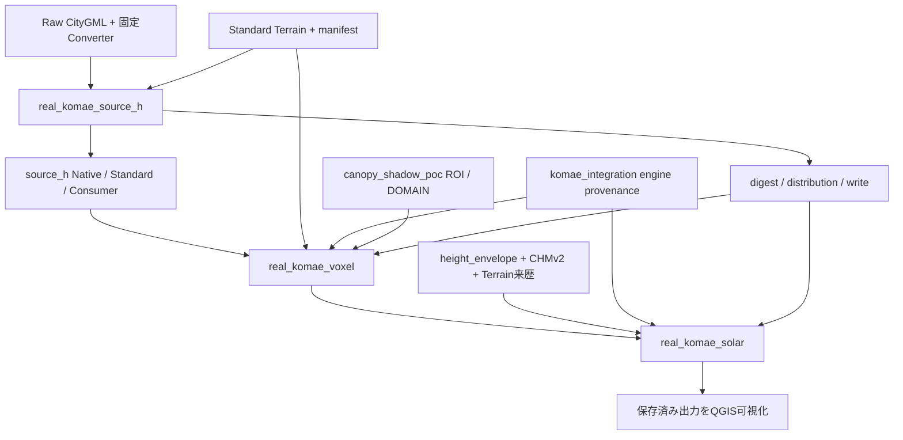

# OUEM End-to-End PoC後のリポジトリ棚卸し・整理計画

調査日: 2026-10-28（Windows、通常OUEM venv）。対象: GitHub main `3d767f039b6542edf37b01025f92084daf3ed6e9`、PR #99 merge。

GitHubのmainを `git ls-remote` で照合しfetchした。ローカルmainは古いため対象にしていない。checkoutせず対象commitの `ls-tree` / `cat-file` から全管理対象を集計・AST解析した。現在の作業ブランチとmainのファイル差分はなし。調査スクリプト・本書・一覧はすべてGit管理外に保存。追跡ファイル変更、削除、移動、commit、push、PR作成、実データ再計算は行っていない。

## 1. 結論と優先順位

削除による軽量化より、現行入口の更新と責務の可視化が先。全234ファイルで約2.91 MiBに収まり、大容量実データの混入は確認されなかった。READMEとCurrent Stateは以前のbaselineに留まり、PR #97–#99で実装・実行済みの探索的source-H実都市経路へ十分に案内していない。一方、その達成はFormal Acceptance、StandardのFINAL化、source-H eligibilityやPhase 5 Gateの変更ではない。

推奨する最初の整理PRは **「docs: index the completed exploratory Komae E2E lane」**。READMEと2つのCurrent Stateに既存の3組のREADME/RESULTSへのリンク・境界・再現順序を追記する。新しい仕様書や同じ数値表を増やさず、正式受入記録とGateを変更しない。コード移動・削除・共通化は含めない。

分類: KEEP 219 / CONSOLIDATE 10 / ARCHIVE 5 / DELETE CANDIDATE 0。全ファイルの区分は `classification.csv`。これは整理の主たる観点を1つ付したもので、ARCHIVEは現時点の物理移動・削除の推奨ではなく、歴史的入口として区別する候補。KEEPも将来の調査不要を意味しない。

## 2. 構成・ファイル数・容量

容量は対象commitのblob実バイト合計。Git pack/.git履歴容量、ローカルCRLF展開、venv、ignoredデータは含まない。

| ディレクトリ | ファイル数 | バイト |
|---|---:|---:|
| ルート直下 | 5 | 21,070 |
| .github | 1 | 555 |
| config | 1 | 222 |
| data | 15 | 3 |
| docs | 74 | 1,760,109 |
| experiments | 1 | 3,425 |
| scripts | 25 | 126,168 |
| src | 61 | 653,625 |
| tests | 51 | 488,693 |
| 合計 | 234 | 3,053,870 |

形式別: Python 117（1,157,921 bytes）、Markdown 70（1,068,690）、CMD 15（17,223）、JSON 6（57,258）、PNG 3（726,353）、GML fixture 1（23,554）、TOML/YAML/YML各1、拡張子なし19。3枚の記録PNGが約23.8%を占めるが、実行証拠なので容量のみを理由に削除しない。

`tracked-files.csv` に全path/blob/SHA256/bytes、`directory-summary.csv` に最下層ディレクトリ別、`top-level-summary.csv` / `extension-summary.csv` に集計を保存。data内の15ファイルはディレクトリマーカー。小規模GML fixtureの追跡は意図的で実データ混入とは区別する。

Python用途別（ファイル単位の主分類。意味の異なる大きな__init__.pyは実装として数える）:

| 用途 | 数 |
|---|---:|
| 運用・診断スクリプト | 8 |
| 名前空間・薄い入口 | 17 |
| 取得・Envelope | 3 |
| source-H契約・Consumer・合成接続 | 10 |
| 基本準備・runtime・adapter | 13 |
| 従来Canopy/contained実験 | 5 |
| 診断・来歴・再現 | 10 |
| 実都市E2E orchestration | 3 |
| source-H等の現行回帰（一次自動分類） | 17 |
| その他の既存回帰（一次自動分類） | 31 |

詳細役割・docstring・行数・main有無・被参照数は `python-roles.csv`。用途は重なり得るため、試験の最終的な保護区分は次の別表を使う。

## 3. 実行入口と依存関係

console_scriptsは5つのみ:

| CLI | 対象 |
|---|---|
| ouem-plateau-buildings | ouem.native.building.plateau:main |
| ouem-standardize-buildings | ouem.standardize.building:main |
| ouem-accept-terrain | ouem.native.terrain:main |
| ouem-standardize-terrain | ouem.standardize.terrain:main |
| ouem-adapt-voxcity | ouem.adapters.voxcity:main |

実都市・実験経路は `python -m ouem.real_komae_source_h` → `ouem.real_komae_voxel` → `ouem.real_komae_solar`。console scriptに昇格していないことは未使用の根拠にならない。`__main__.py`、CMD、手動smoke、GIS子workerも別入口。

特に保護が必要な実依存:

- #98/#99が `real_komae_source_h` のdigest/distribution/writeをimport。単なる使い捨てrunnerではない。
- #98は `canopy_shadow_poc` のROI/DOMAINだけを利用。旧投影格子の配列やsolarを流用しているわけではない。
- #98/#99が広い `komae_integration` のenvironment/voxcity_provenanceを利用。旧contained経路ごと除去できない。
- #99は `height_envelope.sample_raster/validate_sources`、#98のsample_dem/effective_ground/audit_voxels、ConsumerのWatch/read_standard等を利用。内部名の変更でも回帰影響がある。
- accepted v0.1 Adapter、4979経路とsource-H実験経路は独立した互換境界。見かけ上類似する変換・validationを安易に統合しない。
- Native/StandardのGDAL workerは文字列パスで別GISプロセス起動される。Python inbound importなしでも必要。

`reference-edges.csv` はAST importとCLI/worker/文書の補助文字参照を区別。`markdown-links.csv` はコードフェンス外の通常inline相対リンク。対象ファイル/ディレクトリの欠損は0。見出しanchor・HTTP・reference-styleリンク・Windows絶対path・動的ロード全般はこの検査だけでは保証しない。AST重複探索では8行以上の関数body完全一致は0（名前/構造変更のある意味的重複や短いhash関数を除外するため、重複なしの証明ではない）。

## 4. 保護する中核とテスト

KEEP: source-H provenance/ingestion/LoD2 xlink/geometry、Standardizer、Consumer、3つのreal runner、既存Building/Terrain/Adapter、acquireとEnvelope、runtime/study_area、固定engine依存、設定、fixture、受入・訂正・ソースZ記録。

試験は `test-classification.csv` に48 Pythonファイルを全件記載:

| 試験群 | ファイル数 | 扱い |
|---|---:|---|
| PR94–99/source-H・実都市回帰 | 10 | KEEP |
| CHM/Canopy・観測点契約回帰 | 8 | KEEP |
| 既存受入経路・運用回帰 | 16 | KEEP |
| 旧実験/診断の特性回帰 | 9 | KEEP、現行機能試験と別案内 |
| 明示実行smoke/fixture | 5 | KEEP、通常pytest収集外 |

AST上のtest_関数は499。parameterize展開後の実行件数ではない。過去の897 passed/5 skipped等はPR99 RESULTSの記録であり、本調査で新たに実行した結果ではない。今回はコードを変更していないためpytest/real smokeは実行していない。

優先保護する列挙: `test_source_h_synthetic_25d.py`、`test_source_h_synthetic_voxel.py`、`test_synthetic_building_solar.py`、`test_source_h_xlink.py`、`test_real_komae_source_h.py`、`test_real_komae_voxel.py`、`test_real_komae_solar.py`、Consumer/ingestion/Standard試験、`test_canopy_observer_geometry.py` / `test_canopy_presence_semantics.py`。さらに既存accepted laneのBuilding/Terrain/Adapter/runtime回帰を残す。

`tests/integration/run_*_smoke.py` は明示opt-in実行であり、名前がtest_でないためCI pytest成功だけで実行済みとしない。`test_import.py` はimportlibでCanopy/model等の名前空間を動的に検査する。空packageを削除しない。

## 5. CONSOLIDATE候補

| 候補 | 根拠と提案 | リスク / 受入条件 |
|---|---|---|
| README + Building/Canopy Current State | Building baseline PR95、Canopy PR75/76。現行実都市3要素PoCへの入口不足。既存RESULTSにリンクして探索的到達点を追記 | Formal/Phase5状態を達成に合わせて上書きしない。重複数値・hashを追加しない |
| scripts/work/README.md | 63,167 bytes、多世代の手順が集中 | まず目次を現行/legacy/歴史証拠に分類。後の分割は既存リンクとWindows例を維持 |
| real_komae_source_h/voxel/solar + komae_integration | runner間でutilityをimport、engine provenanceを大きいlegacy orchestrationから利用 | 第3PR以降に狭い共有API候補を検討。モジュールhash/記録/monkeypatch/APIの破壊リスク。旧記録を書き換えず新実行identityを別保存 |
| run_komae_contained_poc.cmd / contained_e2e.cmd | 同じintegration CLI/固定入力だが後者はportable run-ID、予約語、既存dir、batch構文の検証がある | 同一挙動ではない。安全側wrapperと互換入口、exit code/quote/引数検査の試験が必要 |
| 複数hash関数（横断候補、個別区分KEEPを含む） | adapter/native/acquire/PoCに局所hash実装 | Watch、stat/fstat、TOCTOU、出版ガード、path根拠を同一視しない。短い関数のためだけの大規模抽出は優先しない |

## 6. ARCHIVE候補と削除を見送るもの

ARCHIVE候補5ファイル:

- `scripts/work/diagnose_voxcity_building_ids.py`
- `scripts/work/diagnose_voxcity_id11.py`
- `scripts/work/diagnose_voxcity_id37_overlap.py`
- `src/ouem/gdal_citygml_feasibility.py`
- `src/ouem/plateau_converter_probe.py`

前3つはdataset/ID固定の一時的診断だが、正式A3記録152–154行から明示参照される。後2つはConverter/GDAL代替調査の履歴検証で専用testsと実験記録が存在。現行の入口から歴史区分へ案内する候補であり、証拠再実行に必要な原path/APIは残す。実ファイル移動は互換wrapperと参照移行が必要なので当面不要。

`komae_canopy.py` / exporter / sensitivity / contained経路は過去PoCでもKEEP。現行Envelopeと異なる閾値・provenance・格子の比較証拠であり、testsもある。概念v0.1はv0.2からB1/B2詳細を継承しており、丸ごとarchiveすると現行設計根拠を失う。古いplanning・review・結果は履歴文書として入口を区別し、本文を現代化しない。

**DELETE CANDIDATE: 0件。** 「参照検索なし」を削除根拠としていない。候補に見えたID診断は正式証拠依存、空namespaceは動的import、scripts/.gitkeepはレイアウト履歴、小規模fixtureはConverter比較、記録画像は視覚証拠を持つ。不要性と代替保存・互換性の双方を立証できるものはなかった。これは全ファイルの利用を完全証明した意味ではない。今後削除候補を立てるには実行入口/動的worker/配布対象/記録/外部手順の確認、代替証拠とretention方針、失う再現手順、rollbackを個別に示す。

OpenEarthMap名の追跡テキスト参照は本baselineでは見つからない。ローカルの別試行・大容量成果物をOUEM不要物として扱う根拠にはしない。Git履歴外や別repositoryまで調査したという主張はしない。

## 7. 文書構成・古い記述・所有境界

| 対象 | 観察 | 推奨 |
|---|---|---|
| README冒頭/Documentation Guide | accepted範囲の説明は適切だが、実都市探索的E2Eを発見しにくい | 独立したexperimental laneの短い導線 |
| Building Current State | synthetic solarまで記載、実都市#97–99未反映 | check日/full main hashを更新して実装とGateを分けて追記 |
| Canopy Current State | mixed Building/canopy Phase5未実装という古い時点の案内 | named Phase5計画/承認未完と、別の探索的3要素実装済みを明確化 |
| PR99 RESULTS | 当時QGIS visual未実施と記録 | 過去記録は正しい。後続可視化は別の非正式検証として追記リンク候補。元実行の受入状態を書き換えない |
| READMEの4979・GUI手順 | bounded accepted legacy laneの説明。source-H6697 laneと混同しやすい | legacy accepted / experimental source-Hの見出しを明示 |
| tokyo_23ku_dem_050m path | README自体に歴史pathとTama訂正リンクあり | 誤パスと断定しない。元データ名をrenameしない。新規手順は既存Tama recipeへ |
| Phase A Design v0.1 | historical scaffoldとcurrent-status noteあり | KEEP。現状はCurrent Stateから案内 |
| governance | proposed policy、以前のbaseline | 手順の権威を勝手に格上げせず役割を守る |
| experiments/a1_e2e_pilot | docs/acceptance外にある正式Building証拠入口 | relocationせず現行indexからリンク |

`.md`の通常inline相対リンクに欠損0。ただしconcept継承anchorの旧監査指摘、コードフェンス内のOS別コマンド、ローカル絶対パスは実行保証外。`C:/dev`等は実験の明示artifact rootで、安易な可搬化はhash/provenance制約を壊す。新しい実行の手順と過去の実行記録を分ける。

## 8. .gitignore・ローカル生成物

raw/native/standard/work/model/outputを原則ignore、markerは追跡。GIS形式のglobal ignore、runtime snapshot、venv/cache/.envも対象。保存先がignoredであることを `git check-ignore` で確認する。QGZ/QGS、NPY、JPEG、ZIP、logは全場所共通ではignoreされないため、出力をdata/work以下へ保つ運用が重要。将来global ignoreを広げる場合もsynthetic fixture/意図的証拠を妨げないか確認する。

ローカル実データ/生成物のサイズ全走査・削除はしていない。Git対象だけから不要なdata/workを推定しない。本調査出力やQGIS可視化成果物もGit外に残り、再cloneだけで可視化結果が復元するわけではない。データ保管・バックアップはGitとは別課題。

## 9. ライセンス・出典・再現性の保護

- LICENSEは「repository license未選定 / license grantなし」。OUEMを既にOSS license済みと表示しない。これはローカルファイルの観察で法的助言・現行配布条件の外部調査ではない。
- VoxCityの固定commitとupstream licenseはOUEM licenseとは別。pyproject、engine PEP610/RECORD検証を保持。
- Terrain_Acquisition_PoC、A2 provenance correction/reproducibility、local_handoff provenance JSONがTama source/T.P./元hashを所有。歴史23区pathとは分ける。
- Meta_CHMv2_AOI_Acquisition_PoCはCC BY4.0出典・source snapshot・取得/replay・disk/Git改行差identityの記録。Height EnvelopeのCR=.60と推定HAG・state意味は別契約。
- source-H foundation/ingestion/Standard/Consumer文書、Building CRS vertical review、Converter audit、Native/Standard/probeのevidence JSONと小GML fixtureを保持。定数Z補正やEPSG4979経由H変換へ戻さない。
- PR97–99のREADME/RESULTSは入力/出力hashと限界の安定した入口。local manifests/receipts/reportはignoredでも再現の必須資料。Git履歴だけでは外部binary/Raw bytesを復元できない。
- 後続可視化のGSI航空写真は `data/work/real-komae-visual/inspection-20261028-01/aerial-source.json` とREPORTにURL/hash/撮影時期未検証を記録。原PoCに航空写真を入力したという意味ではない。

## 10. 現行E2Eの再現に必要な最小構成

最小とは「mainからその他を削れる」という意味ではなく、再現パッケージで必要な責務・証拠の集合。

1. pyprojectと固定VoxCity1.7.0 commit、OUEM venv、依存provenance、config/study_areas/komae_09LD3451.yaml、runtime境界手順。GISworkerを使う作業とVoxCity実行は別runtime。
2. Raw CityGML ZIP（2対象member+codelists）と固定nusamai binary、binary hash/Converter revision、source evidence。`real_komae_source_h`、Native/Standard source-H、Consumerと全頂点H照合、Terrain manifest。
3. 同じStandard Terrain、Raw/Native/取得hash-chain。CHMv2 Raw/index/crop/source statement/limited review、既存Envelope上下端/state/manifest。再取得時に旧identityと同一と推定しない。
4. #98 exact saved centres、uv_m/SOUTH_UP、origin/u/v/rotation、IDs/segments、effective ground/DEM/D0/roi mask/voxels/report。EPSG4326 exact-affine TIFFと6677 north-upを配列indexで合わせない。
5. #99 runnerとその依存、共通観測点/TREE不変条件、solar Current/NoCanopy/差分、boundary control、statistics/reportとhash。#98 report/Envelope manifestはpinされ、新たな上流再生成は新identityのレビューが必要。pathだけ新規dirへ差替えて成功扱いできない。
6. 合成回帰とopt-in smokes、PR94–99仕様・手順・RESULTS・既存正式受入/訂正資料。
7. 可視化再開には別途ローカルQGZ・source参照・背景cache・可視化REPORT。現行Gitに可視化用汎用CLIはない。保存済みprojectはlocal artifactであり、source-H/solarコード再現と別に保管する。

静的importの保守的閉包は26module（`e2e-static-closure.json`）。worker・package marker・記録・依存配布metadataを網羅しないので、これ以外を削除できる一覧には使わない。入口は `docs/experiments/real_komae_{source_h,voxel,solar}/README.md` の順。現在の保存成果物を検証して再利用する経路とRawから再生成する経路を分ける。

## 11. 推奨PR分割・実施順と受入

| 順 | PR候補 | 変更範囲 | 受入・リスク |
|---|---|---|---|
| 1 | docs: index completed exploratory Komae E2E | README、Building/Canopy Current Stateの3ファイル中心。既存実験へのリンク、実装/技術検証/未受入の境界 | 全リンク解決、fullmain baseline、hash/数値の二重管理なし。Standard/acceptance/Gate本文・状態のdiffなし |
| 2 | docs: separate current and historical runbook navigation | scripts/work README目次整理。必要時だけ旧sectionのpermalink互換を残す分割 | 全CLI例を既存parser/Windows quotingと照合。Tama訂正・旧pathを保存。新規実データ実行を必須にしない |
| 3 | refactor: isolate narrowly shared experiment utilities | まずengine provenance/純粋I/O/ROI依存を候補比較。必要性が小さければ見送る | 関連回帰→全pytest。受入はbyte/value invariance、hash/Watchガード、consumer、engine identity、class/observer不変。変更コードidentityを旧記録へ遡及しない |
| 4 | chore: consolidate contained Windows launchers | 安全側wrapperと互換旧name。独立PR | portable run-ID/予約語/引数余剰/既存dir/quote/exit codeを試験。unsafe側へ共通化しない |
| 5 | docs: historical diagnostic catalog | A3 ID/Converter/GDAL調査の歴史ラベル、現pathは維持 | frozen証拠へのリンク・手動再実行方法・tests保持。物理移動/削除は別レビュー |

コードPRの共通受入: relevant tests、その後OUEM venvの `python -m pytest -q -ra`。CIはUbuntu/Windows Python3.12でsynthetic/unitを実行するが、ローカルQGISや実データsmokeの代替ではない。PR94–99の再現性に触れる場合は保存入力をhash検証し、必要に応じ新しいignored runでopt-in smoke、数値/マスク/ID/H/CRS/ground/observerの比較と旧入力不変を確認。Windows symlink skip等は実際の数と理由を報告。小さな文書PRでsolar再計算はしない。

最重要リスク: 成果達成を正式受入に読み替えること、旧H/4979の意味をsource-Hへ混在させること、格子方向/CRSの誤統合、module hash/manifest byte identityの破壊、外部workerや歴史証拠をunusedと誤判定すること。全整理PRで確認する。

## 12. 調査の限界・成果物

本調査は静的Git tree監査と一部local成果物の所在確認。未実行のreal再現、pytest、外部licenseの最新確認、全Git履歴/全PC探索、全Markdown anchor検証、動的call graphは行っていない。依存edgeの文字参照は利用の証明ではなく補助情報で、候補判断は役割・入口・受入記録・testsを合わせた。

成果物: 本書、tracked-files/directory/top-level/extension一覧、python-roles、reference-edges、markdown-links、classification、test-classification、duplicate-function-bodies、e2e-static-closure、summary、監査スクリプトと対象テキストcorpus、verification/manifest。データや既存成果物は削除していない。
