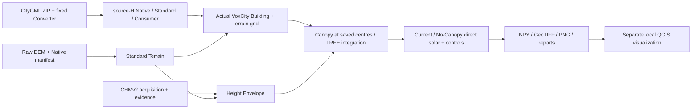

# Existing E2E architecture audit — OUEM v0.2 Phase 1

Status: **static audit and implementation proposal**, 2026-10-28; baseline main
`76689c049b71226aed952c66da27db69c1fdeef0` (PR #104 merged).
Apply the [Development Principles](../OUEM_Development_Principles_v0.1.md).
No refactoring, model run, new dependency, environment repair or acceptance decision.

## Recommendation and first reuse target

First move the evaluation rectangle to an adjacent area **within the same existing
Building/Terrain/Envelope coverage**, keeping EPSG:6677, 1 m voxels, source-H
profile, optical/observer assumptions and engine pin. Reuse the prepared Standard
and Envelope; do not rerun acquisition/Converter merely to move the ROI.
Add a small experimental run configuration and remove scene-size assumptions from
the Building/Terrain and solar stages. A general source framework, new regional
copies and a mandatory all-stage orchestrator are unnecessary for this target.

## Actual execution path and boundaries

This is a manually sequenced pipeline, not one existing CLI. All model stages use
the OUEM venv; GIS child Python is separate. Each stage below already accepts
explicit input/output paths and requires provenance or new output locations.

| Stage / actual entry | Inputs → outputs; implemented boundary |
|---|---|
| [Terrain acquisition](../../src/ouem/acquire/tokyo_tama_dem.py), then `ouem-accept-terrain` / `ouem-standardize-terrain` | Fixed Tama tile → Raw / Native manifest → unchanged-grid Standard TIFF + manifest; [procedure](../Terrain_Acquisition_PoC_v0.1.md). Existing Standard reused in this PoC. |
| [Building](../../src/ouem/real_komae_source_h.py), `python -m ouem.real_komae_source_h` | `--zip --converter --terrain --study-area --artifact-root --run-dir`; two LoD2 members + fixed binary → Native/Standard GPKG, receipts, Consumer and Terrain diagnostics; [procedure/results](../experiments/real_komae_source_h/README.md). |
| [CHMv2](../../src/ouem/acquire/meta_chmv2.py), `python -m ouem.acquire.meta_chmv2` | `--study-area --raw-dir --work-dir`, optional local index/tiles → EPSG:3857 crop + acquisition record. This record alone is not the HAG/DEM evidence bridge. |
| [Envelope](../../src/ouem/height_envelope.py), `python -m ouem.height_envelope` | CHM/acquisition/source-evidence + Terrain/manifest/acceptance + study area → absolute top/bottom, validity state, manifest; `--cr --resolution --dem-sampling` already exist. [Contract](../CHM_Height_Envelope_PoC_v0.1.md). |
| [Voxels](../../src/ouem/real_komae_voxel.py), `python -m ouem.real_komae_voxel` | `--building-manifest --terrain --study-area --artifact-root --run-dir`; fresh Consumer, actual engine rasterization/ground/voxelization → centres/grid/ROI, IDs/segments, raw/effective ground/D0, voxels, GIS diagnostics/report. [Procedure/results](../experiments/real_komae_voxel/README.md). |
| [Solar](../../src/ouem/real_komae_solar.py), `python -m ouem.real_komae_solar` | `--base-run --envelope-run --study-area --artifact-root --run-dir`; fresh validation, public Voxelizer and solar API → paired voxels, masks, direct maps, categories, statistics, controls and GIS output. [Procedure/results](../experiments/real_komae_solar/README.md). |
| GIS delivery | `export_outputs` / `export` above write exact-affine EPSG:4326 GeoTIFFs, GeoJSON/PNG. Later QGZ/aerial comparisons came from ignored `data/work/real-komae-visual/inspection-20261028-01/` scripts and saved project, **not a tracked reusable CLI**. Old `komae_canopy_qgis_export` consumes a different legacy integration schema and is not a drop-in substitute. |

Local PR97/98/99 report JSONs were inspected: each records COMPLETED; source-H
eligibility/acceptance remain unestablished/unverified. No input hashes were
revalidated and no historical success was reproduced by this audit. The owning
RESULTS retain full measurements and execution evidence; they are not duplicated here.

The accepted v0.1 lane remains separate: Converter GPKG/4979 Native → Standard →
[versioned Adapter](../OUEM_VoxCity_Adapter_v0.1.md) / A3. The experimental
source-H candidate manifests are not added to its whitelist. Envelope is not full
Standard Canopy; fixed direct solar is exploratory B1, not scientifically validated
exposure or annual assessment. Standards, Acceptance and Phase 5 gates stay unchanged.

## Extents: input coverage, analysis and actual computation

The [study-area YAML](../../config/study_areas/komae_09LD3451.yaml) describes the
400×300 m preparation/selection area, not the current solar ROI. `ROI` and `DOMAIN`
are separate globals in [canopy_shadow_poc.py](../../src/ouem/canopy_shadow_poc.py)
(lines 27–28): 64×64 m evaluation and a 128×128 m projected reference with 32 m
margin. The real voxel runner imports these constants only, not that older model.
VoxCity defines the actual geographic lattice from transformed rectangle corners;
saved centres, affine u/v vectors, orientation and ROI mask are authoritative.
The projected rectangle and engine parallelogram are not identical geometries.

**Proposed minimum:** analysis bounds + context buffer (default 32 m) derive a
projected computation reference; save the actual engine domain separately as
output metadata. Context is the surrounding occluder region within that domain,
not a third independent configurable rectangle. Keep input coverage/preparation
extent separate and require it to cover all needed samples/objects. Do not change
canonical study-area selection simply to move analysis bounds; full buildings
must remain uncut and the all-Standard ID mapping must stay traceable.

If asymmetric/manual context later proves necessary, an explicit domain override
is an alternative, not part of the first target. Domain coverage does not prove
shadow sufficiency: the existing known-height directional bound and ROI-crop
controls are not expanded-domain convergence. Retain UNVERIFIED when exterior
coverage is unknown. Rotated/nonrectangular ROI masks are outside the first target
because `solar_pair` currently requires a rectangular centre-index crop.

## Configuration candidates and retained constraints

| Priority / code evidence | Minimum change or deliberate retention |
|---|---|
| **P0: analysis/domain** — `real_komae_voxel.prepare_buildings/execute_model/run`, ROI/DOMAIN imports and ROI-module watch | Pass a validated experiment extent specification throughout selection/QA/grid creation. Validate finite ordered bounds, ROI containment and input coverage; include config bytes/hash in provenance. Do not extend or silently repurpose the accepted `StudyArea` contract. |
| **P0: run binding** — solar `BASE_REPORT_SHA`, `ENVELOPE_SHA`, `preflight` | Accept explicit expected report/Envelope hashes in reviewed run config; retain schema, status, all dependency hashes, fresh Consumer, source semantics and engine checks. Path-only or `allow-unpinned` bypass is not equivalent. Baseline config must bind the existing identities exactly. |
| **P0: grid shape** — solar `[128,128,27]`, `np.indices((128,128))`, segments allocation, Envelope `(300,400)`, export `origin+128*u`, fixed TIFF/section dimensions | Derive dimensions/affine/section extent from validated grid/arrays and Envelope metadata. Preserve 1 m and fixed base-grid Z within each pair; if trees exceed occupied Z capacity, fail as now. Automatic vertical expansion needs a separate decision. |
| **P0: identity and paths** — existing CLI path arguments / `Watch` confinement | Reuse arguments; config references existing study-area and manifests, input roots, output parents and run IDs. No auto-discovery/download/overwrite. Paths under the artifact root and absolute paths inside old evidence need consistent resolution. |
| **P0: scene eligibility** — voxel requires selected/owned Buildings; solar requires TREE, ROI reduction and nonempty statistics masks | A different rectangle may legitimately have no canopy effect or no Buildings, yet current PoC completion fails. Decide whether the first reuse target must satisfy these scene prerequisites or should report a valid zero-effect case; do not silently weaken the baseline assertions. Keep strict NoData/coverage rejection. |
| **P1: solar conditions** — `AZIMUTH/ELEVATION/DNI`, repeated calls in `solar_pair`, plot scales | One condition object can feed all five calls, metadata, halo check and plots. First adjacent run keeps the baseline conditions. Expose only validated ranges; changing sun changes context requirements, not just an image title. |
| **Retain first:** EPSG:6677/4326, 1 m, .3 contributor threshold, rounding/ground rules, 2 m roof budget, 3 m exploratory bottom flag | These span adapter/engine semantics or validated scope, not incidental region strings. Do not turn them into arbitrary knobs. Other CRS/resolution is future work requiring broader tests/contracts review. |
| **Retain first:** CR=.60, k=.6, LAD=1, requested observer 1.5 m / no roofs; source-H 6697/6668/6695 | Scientific/model assumptions must be declared and held fixed for behavior comparison. Configuration exposure is not approval of alternative assumptions or physical DEM+1.5 m observations. |
| **P2 only:** Building `MEMBERS`, Converter SHA/options; Tama URL/tile/hash; different CHM release | Existing two members and coverage may suffice for an adjacent rectangle. New tile/release/binary support is conditional on coverage failure, not needed preemptively. Do not parameterize mandatory identity checks into optional validation. |
| **P1 GIS:** local visualization run paths, fixed display bounds/ROI frames, 128 indexing, fixed sun labels/QGIS layout | If reusable PNG/QGZ is in the next completion criteria, promote only the needed read-only export path and derive scene values from grid/statistics. GeoTIFF delivery already exists; aerial download and general styling framework are unnecessary. |

A small JSON run config (stdlib, no new parser dependency), referencing the
existing study-area YAML, is the recommended option. Its loader must reject
duplicate/unknown keys and nonfinite bounds; the existing small YAML loader is
not a general strict experiment-config validator. CLI overrides alone are a
viable smaller alternative if few fields suffice; mixing independent defaults
across stages is the risk. Record resolved settings once and require both stages
to agree. Exact filename/schema and whether QGZ automation is required need review.

## Complexity and smallest work sequence

1. **P0 baseline and config boundary:** preserve an immutable baseline checkout/input
   locator chain before editing watched source files; add strict extent/input-binding
   validation and a baseline config without changing algorithms. Existing reports
   watch implementation files as inputs: editing those files at their recorded paths
   can invalidate old report verification. Do not “fix” old reports/hashes. Use intact
   historical locators or explicitly reviewed new runs for comparison.
2. **P0 voxel + solar connection:** thread config through existing functions/CLIs,
   remove fixed dimensions, generalize GIS affine/plot bounds. Reuse one validated
   actual-grid description. Keep old default/explicit baseline invocation available
   with its fail-closed identity checks; new run identities are separately recorded.
3. **P0 validation, then authorized adjacent E2E:** compare baseline and translated
   case as below; update existing stage READMEs for config use. No new Komae clone.
4. **P1 only if required:** small read-only visualization entry using saved outputs;
   QGIS stays a separate existing GIS child. Lightweight stage coordination can
   follow proven repetition, not precede extent reuse.

The main coupling is runners serving as utility libraries: voxel/solar import
`write/digest/distribution` from the Building runner, provenance from broad
`komae_integration`, and voxel constants from canopy-only code. Isolate extent
ownership now; extract other utilities only if it simplifies these changes.
Repeated array/affine writes merit a small helper if both consumers need it.
Independent Consumer, scalar voxel/segment checks and provenance validation are
intentional cross-checks, not duplicate logic to delete. Legacy CMD cleanup is
not on the critical path; no new wrapper/plugin framework is proposed.

## Regression, new-area verification and decisions

Keep existing [source-H](../../tests/test_real_komae_source_h.py),
[voxel](../../tests/test_real_komae_voxel.py), [solar](../../tests/test_real_komae_solar.py)
and synthetic/Consumer/accepted-lane regressions. They cover internal xlinks/H,
NoData/CRS, owner/ground/rounding/segments, pair priority, shared observers/sign
and crop controls. Gaps: alternate extents end-to-end, non-square grid export,
valid alternative report binding, rejected settings, both stages consuming one
resolved config, and positive full preflight beyond the current wrong-hash test.

Before real runs, add translated synthetic and non-square fixtures; catch stale
ROI globals, wrong pixel-centre/flip/transpose mapping, altered masks, forged
provenance, NoData/coverage loss, empty/zero-effect scenes and trees exceeding base Z. Keep nearest sampling,
full geometry, engine pin, D0/ground, IDs and TREE-only case difference invariant.
Then run focused suites and full pytest in the OUEM venv. Baseline comparison
requires exact numeric arrays/masks/IDs/centres (NaNs equal), H retention and
solar results under unchanged settings, with any unavoidable environment tolerance
explicitly reviewed. New report/file hashes may differ from timestamps/code paths;
never confuse semantic reproducibility with byte equality or relax source hashes.

For an **authorized future** real smoke, a candidate is the ROI translated 64 m
west (touching the current ROI), with the same size/margin, within the present
preparation bounds. Verify actual Building/DEM/Envelope coverage first; this is
not a claim those samples have been checked. Generate new runs, rerun Consumer
and all input guards, inspect retained boundary buildings, grid/ID/vertical and
pair diagnostics, observer masks, solar sign, ROI statistics and GIS XY/Z.
Do not expect the new area's cell values to equal the old ROI. Evaluate halo
bounds anew; expanded-domain convergence, if authorized, is a separate test.

Confirm before implementation: JSON config vs minimal CLI; whether the target
requires QGZ or only existing GeoTIFF/PNG; ROI/context selection and response to
insufficient halo/Z coverage; treatment of legitimate zero-effect/empty scenes.
No scientific assumption, major dependency or
formal contract change is necessary for the recommended first target. Broader
CRS/source/resolution support and physical observer/optical changes require the
user's explicit decision and evidence; this audit does not authorize them.

Runtime check was static only: `.venv/pyvenv.cfg` still records Python 3.11.9;
its referenced executable now exists (unlike the PR104 observation), but import,
engine metadata and actual interpreter health were not tested. No environment
repair or model/test execution occurred. This document records a plan, not a new
execution or Acceptance result.
