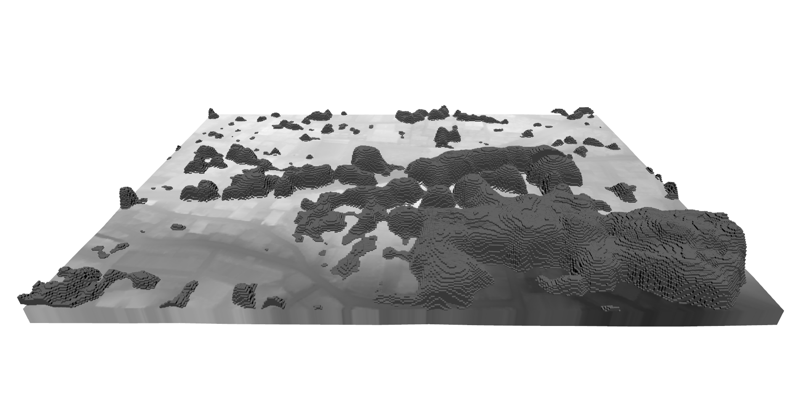

# OUEM Height Envelope 3D Visualization — Komae技術検証記録

検証・証拠整理日: 2026-10-26 JST。Status: **技術検証記録案／独立レビュー待ち**。独立レビューに提供する証拠整理であり、この文書の作成者が独立した専門家として受入承認した記録ではない。

対象: `data/work/height-envelope-3d/komae-20261026-01/`。既存実データ・既存派生成果物を読み取り再確認した。Height Envelope／GeoPackageの再生成、アルゴリズム変更、新しい実データ実験、QGIS GUIの再実行は行っていない。

**確認結果: 保存データのハッシュ・格子・全地物の幾何／属性・押出計算は整合。既存PNGと前回のGUI記録により実QGISでの描画を確認できる。画面上の幾何精度・空間的適合性・科学的精度の保証は含まない。**

この記録の「今回」は2026-10-26の保存成果物の証拠整理を指す。PR化では既存の読取照合を再実行したが、既存JSONの書込行はメモリ上で無効化し、ローカル実行ログを更新していない。新しい生成・GUI実行の記録ではない。

このPRに含めるのは本記録と代表PNGの2件のみ。以下のローカル証跡識別子はリポジトリrootを基準とする。個々のファイル名は、特記がなければ可視化run内を指す。元資料はローカル `REVIEW_PACKAGE.md`、`RESULTS.md`、`QGIS_3D_GUIDE.md`。ローカル絶対パスは環境依存であり、第三者の取得先やGitHub公開URLではない。

## レビューの入口と証拠区分

| 区分 | 根拠 | この資料で言えること |
|---|---|---|
| 今回実ファイルを確認 | SHA-256再計算、GeoPackage再読込、全セル照合、QGZ内XML、PNG読取 | 保存データの同一性、幾何と属性の数値整合、保存された表示設定 |
| 前回の実操作・記録 | `RESULTS.md`（RESULTS.md、ローカル証跡）、`visualization-verification.json`（visualization-verification.json、ローカル証跡）、実出力PNG | QGIS 4.2.3で立体・下端面・上下端面を切替表示した事実。今回の再操作成功という意味ではない |
| 設定・計算に基づく判断 | Absolute Z＋thickness属性、後述の数値照合 | 意図する押出上端が保存上端に達すること。GPUの実描画座標を回収・計測した結果ではない |
| 未検証 | 独立測量・現況画像照合・再起動試験等なし | 樹高・下端・位置精度、現実の樹冠境界、別PC表示、GUI再起動後の3Dビュー復元 |

関連ファイル:

- `RESULTS.md`（実行報告 RESULTS.md、ローカル証跡）
- `QGIS_3D_GUIDE.md`（QGIS操作手順 QGIS_3D_GUIDE.md、ローカル証跡）
- `komae_height_envelope_3d_verified.qgz`（表示用QGISプロジェクト、ローカル証跡）
- `canopy_cells_visualization.gpkg`（可視化用GeoPackage、ローカル証跡）
- `qgis_3d_overview.png`（実QGIS全景PNG、ローカル証跡）
- `review-evidence/saved-artifact-verification.json`（今回の機械可読照合結果、ローカル証跡）
- `review-evidence/verify_saved_artifacts.py`（今回実行した読取照合スクリプト、ローカル証跡）
- `data/work/height-envelope/komae-exploratory-20261026-01/RESULTS.md`（元Height Envelope実行報告、ローカル証跡）
- `data/work/height-envelope/komae-exploratory-20261026-01/independent-verification.json`（元Height Envelope独立QA、ローカル証跡）

`debug/initial_project_failed_validation_DO_NOT_USE.qgz`は初回失敗試行であり、レビュー対象の正しい表示プロジェクトではない。使用するのは `_verified.qgz` のみ。

## 入出力の同一性

以下は今回実ファイルからSHA-256を再計算した結果。元Height Envelope manifestは `ouem-height-envelope-poc/v0.1`、状態 **COMPLETED**。3枚のTIFFはその `outputs` と一致。GeoPackageは `derivative-manifest.json` と一致。プロジェクト・PNGを含む既存 `artifact-inventory.json` の14件も全件一致した。

| 区分／ファイル | bytes | SHA-256 |
|---|---:|---|
| 入力 `canopy_top_z.tif` | 308739 | `65263bb32aa846688b3fecee3e7b0893c6a9d6f2e8fa9eebaf95c0bc576aed17` |
| 入力 `canopy_bottom_z.tif` | 298845 | `61e82f1d8e9c1c4afc653bf6d850cc35052535fd643462da0b89403efeda158e` |
| 入力 `height_envelope_state.tif` | 1724 | `6a3debfbcd220d6bef9cdb736cc7d8abd545ee3156121746e019093edef71992` |
| 入力 `height_envelope_manifest.json` | 11829 | `6121cbf732f8ece9553013be2483203f08faf9a8d364136a919c184b46738d68` |
| 派生 `canopy_cells_visualization.gpkg` | 25432064 | `b41c54732cdef2dfbe88d1ba369ecfcff8af37e7a38d35bf71071edefc665661` |
| 保存済み `_verified.qgz` | 12325 | `f4b7000bf9a4e77690dd1dec4094050d602dd0dc0e381a741196add23cc503aa` |
| 実表示 `qgis_3d_overview.png` | 405213 | `77597476dae87104670e70679f26c60dd3f43b1415d8246c34ec7bf36ef1b7b8` |

TIFFとmanifestは `data/work/height-envelope/komae-exploratory-20261026-01/generated/`。上流のCHM・Terrain・取得記録・evidence bridge等も元manifestの `input_files` に対し実ハッシュを再照合し一致した。詳細は今回JSONの `upstream_input_hashes_rechecked`。

主な上流の指紋:

- CHMv2 AOI: `c5f99a4e9b21e8f419825ef2cac25ec7b36bafbe8a79a89b062201343f0ef880`
- 受入済みStandard Terrainと同一のTIFF: `0afb6d1706b97bd39c8c93ff8feb580094fe585f567e2de1f2081c082602f90a`
- Evidence bridge: `afdf8560ac1d7a94cf599ffaa7fe17bbba29df5fca7a61df994052cdc04bf6a9`

ローカル絶対パスはJSONに実行場所の証拠として残る。移設時はdata/work内の相対配置とデータファイルを維持し、パス解決を再確認する。QGZだけを別PCに渡しても入力一式は付属しない。ハッシュ一致は内容同一性であり、今回あらためて生成を再実行してバイト再現性を実証したという意味ではない。

## 生成条件・件数・処理時間

| 項目 | 条件・結果 | 証拠 |
|---|---|---|
| 方式 | 1mセル下端面のPolygonZ＋厚さの描画上押出。連続面の補間・溶解なし | 生成スクリプト／全地物照合 |
| 格子 | EPSG:6677、1m、400列×300行、north-up、中心値をセル面全体へ適用 | 今回3TIFF確認 |
| 範囲 | x=-23600..-23200、y=-40800..-40500 | 今回metadata確認 |
| affine | [1,0,-23600,0,-1,-40500] | 今回metadata確認 |
| 上流条件 | CR=0.60、CHM/DEM nearest、Z_top=DEM+CHM、Z_bottom=DEM+0.4×CHM | 既存Height Envelope manifest／報告 |
| 全セル／state=1 | 120000／120000。他state=0 | 今回TIFF集計 |
| 表示除外 | state≠1、またはHAG≤0、またはtop≤bottom。今回はHAG=0の79211セルのみ該当 | 今回選択集合照合 |
| 表示対象 | 40789セル、間引きなし、3m等の閾値なし | 今回両レイヤ全地物照合 |
| TIFF NoData | 上端／下端Float32、-9999。state UInt8、NoDataタグなし | 今回metadata確認 |
| マスク欠損 | 3TIFFとも0セル | 今回実読取 |
| 派生生成日時 | 2026-10-26 21:50:50 JSTの記録 | derivative-manifest.json |
| 派生生成＋再読込検証 | 3.4212068999913754秒（約3.42秒） | 既存生成時記録。今回計時し直していない |
| 実行環境 | OUEM Python3.11.9、GeoPandas1.2.0。プロジェクト設定は別プロセスのGIS Python／QGIS4.2.3 | 既存RESULTS・設定worker記録 |
| GUI性能 | 描画確認済み。初回ロード秒数・FPS・GPUメモリは未計測 | 前回GUI記録 |

元Height Envelopeの実行mainは `c019e08708ce66ca16ee2883384cc4b8d7bb1d80`。ローカル可視化スクリプトはGit未登録の実験証跡であり、そのmainに実装がコミット済みという主張はしない。入力コードの改行差と実行モジュールhashの関係は元Height Envelope RESULTS.mdを参照。

## GeoPackageの構造と幾何

| レイヤ | Geometry | CRS | 地物数 | 各頂点のZ |
|---|---|---|---:|---|
| `envelope_cells` | PolygonZ | EPSG:6677 | 40789 | 当該セルの保存済み `bottom_z` |
| `top_faces` | PolygonZ | EPSG:6677 | 40789 | 当該セルの保存済み `top_z` |

GeoPackageの `gpkg_geometry_columns` は両者 `geometry_type_name=POLYGON`、`srs_id=6677`、`z=1`（Z必須）、`m=0`。ジオメトリ列は `geom`。全地物について、単一の閉じた5座標リング、1m²、元row/colに対応するXY範囲、全頂点のZ、属性の元TIFF一致を実確認した。row/colの重複なし。地物数合計81578は同じ40789セルの上下2面であり、樹木81578本ではない。

両レイヤのフィールド:

| フィールド | 保存型 | 意味 |
|---|---|---|
| `fid` | INTEGER PK | GeoPackage内の地物ID。セルや樹木の永続IDではない |
| `geom` | POLYGON + Z必須 | 1mセルの下端／上端水平面。閉ソリッドではない |
| `row` | INTEGER | 元1m格子の0始まり行。北から南へ増加 |
| `col` | INTEGER | 元1m格子の0始まり列。西から東へ増加 |
| `top_z` | REAL | 元Float32上端値を損失なく保持した絶対標高m |
| `bottom_z` | REAL | 元Float32下端値を損失なく保持した絶対標高m |
| `thickness` | REAL | **保存済みtop_z−保存済みbottom_z**。CR式を別途計算した値で置換していない |
| `hag_m` | REAL | 元runの1m nearestサンプルCHM相対高m |
| `state` | INTEGER | Height Envelopeの数値validity。全地物1。樹冠存在分類ではない |

下端の絶対標高は `bottom_z` 属性と `envelope_cells.geom` 全頂点のZの両方に保持。EPSG:6677は水平CRSであり、鉛直基準を与えない。Zは既存Terrain由来の **source-declared T.P.** に相対CHMを組み合わせた推定値であり、独立測量済みではない。

選択条件の実装は `(state == 1) & (hag_m > 0) & (top_z > bottom_z)`。今回データではHAG=0とtop=bottomの集合が一致していた。ゼロ除外は可視化の暫定処理で、樹冠不存在の正式判定ではない。負のHAG等の新しい受入基準を設けたものではない。

## 押出上端の数値検証

今回、保存済みGeoPackageを再読込し、**下端ジオメトリの実頂点Z＋thickness属性**を元上端TIFFと比較した。両レイヤ全40789セルで残差0m。`top_faces`の頂点Zも元上端TIFFと全件一致した。

代表セルは表示対象の先頭セル、正HAG中央値9mの代表、上端最大セルと西／東隣接セル、保存厚さ最大セルを選択した。行列は0始まり。以下はm、表示桁は読みやすさのため丸めている。丸め前の数値と残差はJSONに保持。

| 選択 | row,col | HAG | 下端の頂点Z | thickness | Z＋thickness | 元上端TIFF | 残差 |
|---|---|---:|---:|---:|---:|---:|---:|
| 先頭表示セル | 0,212 | 1 | 25.215000153 | 0.600000381 | 25.815000534 | 25.815000534 | 0 |
| 正HAG中央値の代表 | 70,233 | 9 | 27.812000275 | 5.399997711 | 33.211997986 | 33.211997986 | 0 |
| 最大上端の西隣 | 249,355 | 22 | 31.383998871 | 13.200000763 | 44.583999634 | 44.583999634 | 0 |
| **最大上端** | **249,356** | **23** | **31.833000183** | **13.799999237** | **45.632999420** | **45.632999420** | **0** |
| 最大上端の東隣 | 249,357 | 22 | 31.443998337 | 13.199998856 | 44.643997192 | 44.643997192 | 0 |
| 保存厚さ最大 | 242,303 | 23 | 31.155000687 | 13.800001144 | 44.955001831 | 44.955001831 | 0 |

最大上端中心: **x=-23243.5、y=-40749.5**。厚さ最大中心: x=-23296.5、y=-40742.5。上下端を個別Float32保存したため、厚さと理論値 `0.6×HAG` の最大差は **3.051757813565814×10⁻⁶m**。これは保存値の丸め差であり、科学的精度の推定値ではない。上端最大セルと厚さ最大セルが異なることも、この微小丸め差とDEMの違いに注意して読む。

この検証はCPU上の保存値の数値計算である。QGIS rendererがその設定で押し出すという解釈は、保存されたAbsolute/offset0/thickness設定と前回GUI表示に基づく。GPUから全頂点を逆取得して期待Zと照合したわけではない。

## 保存済みQGIS 4.2.3表示設定

以下は今回QGZ内のQGS XMLから読んだ設定。プロジェクトCRSと3DビューCRSはEPSG:6677。

| QGIS表示レイヤ | GeoPackageの実レイヤ | renderer／symbol | 高さ基準 | 押出 |
|---|---|---|---|---|
| `Canopy envelope cells — bottom + thickness` | envelope_cells | vector／polygon | Absolute、Vertex、offset=0 | data-defined `extrusionHeight`、field=`thickness`、active=true |
| `Bottom faces — absolute Z (toggle for underside)` | envelope_cells | vector／polygon | Absolute、Vertex、offset=0 | 固定0 |
| `Top faces — absolute Z (toggle separately)` | top_faces | vector／polygon | Absolute、Vertex、offset=0 | 固定0 |

立体セルのXML固定 `extrusion-height=0` は既定値であり、実際はactiveなdata-defined thicknessが優先する設定。top_z属性を押出高さへ直接渡していない。下端ジオメトリZを基準に差分だけ押し出し、地形標高を再加算しない。Relative/Terrain clampingに変更しない。

3レイヤともadd-back-faces=1、culling=no-culling、edges=off。押出面設定はWalls|Roof。下端の閉キャップを備えた正式ソリッドという契約ではなく、下端は専用面レイヤで比較する。材質はQGIS4のmetalrough、base=128/128/128、metalness=0、roughness=0.5。2Dの緑・橙色とは別設定で、実PNGは灰色。

| 3D地形／カメラ項目 | 保存設定 |
|---|---|
| 地形generator | dem |
| 標高レイヤ | `Accepted Terrain 0.5 m — read-only reference` |
| 参照ファイル | `data/work/terrain-reproducibility/komae-20261026-01/generated/standard.tif`。原本不変 |
| 鉛直誇張率／offset | **1／0m** |
| 地形LOD | タイルresolution16、max-ground-error1、max-terrain-error3、texture-size512 |
| skirt-height | 10m。端の壁は表示補助であり地形の崖ではない |
| 地形shading／shadow | off／off |
| カメラ | 注視点(-23400,-40650,0)、距離400、pitch60°、yaw0° |

カメラ注視点Z=0は標高データを0へ補正する設定ではない。0.5m Terrainを参照するが、画面の地形メッシュが常に0.5mで描画されるという意味ではない。保存XMLにはプロジェクト全体のflat terrain providerも存在するが、この3Dビューは `mapViewDocks3D/view/qgis3d/terrain/generator=dem` の専用設定を持つ。ビュー専用DEM設定を確認対象とし、プロジェクト全体のproviderだけで判断しない。

切替: 通常は立体セルon、上端／下端単独面off。下端確認では立体をoffにしてBottom facesをon。上端はTop facesをon。上下を同時に表示すると上面が下端を遮るため、同じカメラで交互比較する。必要ならTerrainを一時非表示にする。具体的操作は `QGIS_3D_GUIDE.md`（QGIS_3D_GUIDE.md、ローカル証跡）。保存後GUI再起動によるビュー復元、別PCでの表示は未確認。

## 実QGIS画像

**前回QGISの「画像として保存」で出力した全景。今回PNGを再読取し実画像を確認した。1920×970、RGB、405213 bytes。再レンダリング・AI画像生成・画素補完は行っていない。**



公開画像は本節のPNGで、ローカル元PNGとバイト同一。南東側の高値群は全景の手前右側に見える。既存保存画像には独立した南東拡大ビューのPNGはなく、今回は証拠整理に限定して新しいGUI拡大撮影を実施していない。元PNGの拡大表示は可能だが、新しい視点や追加の空間精度検証の代わりにはならない。

前回確認された南東の厚い層・セル段差はこの画像でも見える。1mセル、元CHMの整数値、重複する内部壁、材質陰影やLODが見え方に影響する。「筋が見える」ことだけで現実の樹冠の異常と断定しない。前回の確認候補は最大南隣接段差約10.049m、東隣接約6.987m、4近傍孤立1セル5件（全HAG1m）。根拠は既存RESULTS.mdと元runの診断CSV。今回新しい現況評価はしていない。

## QA・再現性の境界と未解決事項

| 確認項目 | 結果・適用範囲 |
|---|---|
| 入力／派生hash | 今回再照合PASS。既存14件のinventory、元run保護hash、上流manifest入力も一致 |
| 格子／NoData／セル選択 | 今回実読取PASS。全120000セルvalidなので実欠損ケースの挙動の追加実証にはならない |
| 全地物の幾何／属性 | 両レイヤ40789件のXY、面積、Z、row/col、属性、選択集合が元TIFFと一致 |
| 上端到達 | 全件bottom geometry Z + thickness = top raster、残差0m |
| QGIS保存設定 | 今回XML確認PASS。Absolute、DEM地形、誇張1、offset0、厚さ属性押出 |
| QGIS実描画 | 前回の実操作記録＋保存PNG。今回GUI再実行なし。精密なGPU座標検証ではない |
| 生成再実行の決定性 | 今回再生成していない。保存物と生成スクリプト・実行記録の追跡性を提供。GPKG/QGZは生成日時・ID等も含み、再生成byte同一を未実証 |
| 空間／科学的妥当性 | 未承認・未検証。独立レビューで別途評価が必要 |

必須の限界:

1. **樹冠存在範囲は正式判定していない。** 正HAGセルの選択・ゼロ高の除外は表示処理。樹木数・樹種・単木境界・樹林境界を確定しない。
2. **CR=0.60は仮定値。** 下端は一定CRモデルによる推定であり、枝下高の実測値ではない。
3. **取得時期差が残る。** CHMv2対象画像の既存一次metadataは2019-05-25、東京都DEMの提供元期間は2022年7月～2023年1月。DEMの当該図郭の正確な計測日は未確認。局所的変化を解消済みとしない。
4. **水平位置・樹高精度は未検証。** 独立測量、現況オルソ・建物・道路との照合を今回実施していない。source-declared T.P.を独立検証済みに格上げしない。CHM側の地盤面とTokyo DEMの一致も未実証。
5. **セル単位の階段状表現。** 値はセル中心サンプル由来、面は各1mセルで水平。滑らかな樹冠面や正式ソリッドではない。LOD・skirt・画面陰影を実地物と混同しない。
6. **Standard Canopy正式受入ではない。** 正式樹冠ポリゴン生成、voxel化、VoxCity接続、本番環境評価への適合性は含まない。

独立レビューでは、上端・下端の保存方式、差分押出、ゼロ除外の解釈、上流の限定的適合性承認、保存設定と実画面の証拠境界を確認されたい。精度評価が必要なら、次工程で最大上端／最大段差地点に対する時期と出典の分かるオルソ等との比較を別実験として計画する。

## 今回の再確認手順

次のコマンドはローカル証拠整理時に実行済み。**指定runのローカル照合スクリプトを別途保有する環境に限る**。このPRから取得できるCLIではない。OUEM venv／通常PowerShell、リポジトリroot:

```powershell
.venv\Scripts\python.exe data/work/height-envelope-3d/komae-20261026-01/review-evidence/verify_saved_artifacts.py
```

当初の証拠整理時の書込先は、その時点で新規の `review-evidence/saved-artifact-verification.json` のみ。PR化の再照合では書込を無効化して既存JSONも不変にした。SQLiteはmode=ro、GISデータは読取で使用。全地物・元run・既存inventoryの不変性を照合前後に確認した。レビュー資料追加に伴う新規ファイルは過去のartifact-inventoryへ追記せず、そのinventoryの歴史的内容を維持する。

ローカル証拠整理時の追加物はREVIEW_PACKAGE.mdとreview-evidence配下の照合スクリプト／JSON。このPRへはそれらをコミットしない。既存RESULTS.md、QGIS_3D_GUIDE.md、GeoPackage、QGZ、元PNG、コード・契約・正式記録は変更しない。既存実装無変更のためpytestは再実行していない。


## 実行コードと証拠の識別

Height Envelope生成時の環境はPython3.11.9、NumPy2.4.6、Rasterio1.4.4、GDAL3.10.3、PyProj3.7.2。記録されたmain commitは `c019e08708ce66ca16ee2883384cc4b8d7bb1d80`。既存実装は [height_envelope.py](../../src/ouem/height_envelope.py)、契約・CLIは [Height Envelope PoC文書](../CHM_Height_Envelope_PoC_v0.1.md)、Terrain再現性は [既存検証記録](../acceptance/OUEM_A2_Terrain_Reproducibility_Verification_20261026.md) を参照。

実行moduleのdisk SHA-256は `f4be689ef9e380e87dd0606decb486e14f58e67b48e1500bd55edcd39b7189cf`、HEAD内module SHA-256は `ae7bf2defe969307ac317bc261a19cceee32633f90842979e4345daadfc336c6`。元実行証跡でCRLFをLFへ正規化した内容一致を確認したが、byte同一ではない。git_clean=trueだけで実行byte同一とは主張しない。supporting acquisition module SHA-256は `c477c0d820e0f03749bb52f36b3b5c78d65b2cb624bdf0a330ec7c8226203510`、study_area module SHA-256は `e1efffb7cc703dda7526bdc195976b27bbd5344377402d7de3e75ec33ae33aa1`。

可視化・プロジェクト設定・照合スクリプトはローカル未コミットの実行物。以下の指紋で識別し、mainコミットに可視化スクリプト一式が含まれるとはしない。第三者がGitHubの本PRだけで全生成工程を自動実行できる状態ではなく、元入力・ローカル証跡の別途提供が必要。

## 既存14件の保護指紋

元 `artifact-inventory.json` の14件を全件再照合し不変を確認。これは「元TIFFが14枚」という意味ではなく、スクリプト・資料・派生成果物・失敗試行を含む**既存可視化runの14件**。原本TIFFと上流manifest入力は別途ハッシュ照合した。元inventory自体も書き換えていない。

| 可視化run内の識別子 | bytes | SHA-256 |
|---|---:|---|
| `build_visualization.py` | 4947 | `7a92b5536bbfb416241db77491f4f6710bf7b443bfc60ab65a4f642a9aaa0005` |
| `canopy_cells_visualization.gpkg` | 25432064 | `b41c54732cdef2dfbe88d1ba369ecfcff8af37e7a38d35bf71071edefc665661` |
| `create_qgis_project.py` | 3440 | `60d95b7e643885def0f8dce886070869ee4d7dd82c99544f6a4efe1b46d48a70` |
| `derivative-manifest.json` | 945 | `9d97a0653a391ce7e27d872c7a4165c7e2be97d5dc188da015b2174500feab85` |
| `finalize_report.py` | 4654 | `71e0c45d9d741a045ea319f3c23cdac0ea3995b8ffcaac6072d2c8f53e021ed5` |
| `input-verification.json` | 6813 | `3cb3bf9ce115f0837f670df015acd91d8bbb97065b25646a808e871f8364ac71` |
| `isolated_single_cell_review_points.csv` | 672 | `009773793257112dd8f8a3e8980a8a35149a8ce91921dfd60bea6ac95796b08e` |
| `komae_height_envelope_3d_verified.qgz` | 12325 | `f4b7000bf9a4e77690dd1dec4094050d602dd0dc0e381a741196add23cc503aa` |
| `qgis-project-validation.json` | 441 | `b3217c5cfd44434e60d8caa7a9a5abd216c964770fc76fd0c567733a9c6ab834` |
| `QGIS_3D_GUIDE.md` | 3165 | `45aefe5d954b1141e627edb19ecae745806a8952f89c0f26dd9b354977cdd2c7` |
| `qgis_3d_overview.png` | 405213 | `77597476dae87104670e70679f26c60dd3f43b1415d8246c34ec7bf36ef1b7b8` |
| `RESULTS.md` | 10914 | `447266d1523db98235f0d7bc6a72050db43caecd6ec7dfd5fee3ee650f57ba96` |
| `visualization-verification.json` | 1821 | `6be542b69bca4fe216c03f3cf4acb1e446312080ec57ab8756ff3efcbc97d043` |
| `debug/initial_project_failed_validation_DO_NOT_USE.qgz` | 10639 | `be53fef4682c573d9fddee421a2bc27a7bf6526d2b9ae4c49b636d16137139f3` |

## 再現のためのデータ処理仕様と確認順

1. 指紋表のHeight Envelope入力3枚・COMPLETED manifestと上流入力を別途用意し、SHA-256、EPSG:6677、格子、NoDataを照合する。取得・Height Envelope再生成が必要な場合は既存 [CLI仕様](../CHM_Height_Envelope_PoC_v0.1.md) のsemantic gateとevidence bridgeを満たす。空の架空宣言を作らない。
2. 表示対象集合 `(state == 1) & (sampled HAG > 0) & (top > bottom)` を使用。1mセル(row=r,col=c)の左下は(-23600+c,-40501-r)、右上は(-23599+c,-40500-r)。この4隅と始点反復の5座標で1m²のリングを作る。envelope_cellsは全頂点Z=bottom、top_facesは全頂点Z=top。厚さは保存済みtop-bottom。属性・CRSは上表の通り。補間・溶解・間引きはしない。これは既存生成手順の記録であり、新しいアルゴリズムの追加ではない。
3. 両テーブルを再読込し、row/col選択集合、40789件、面積、XY範囲、全頂点Z、全属性をTIFFと照合し、bottom geometry Z + thickness - top rasterの残差を計算する。今回値は0m。
4. QGIS4.2.3で2テーブルを読み、envelope_cellsを複製して立体／下端の表示レイヤを作る。保存設定表と同じ3D記号を設定し、受入済みTerrainを3Dビュー専用DEMとして指定する。
5. pitch60°・距離400・注視点(-23400,-40650,0)から上端／下端／立体を切り替える。PNGは3Dビューの「画像として保存」で出力する。元PNGと異なる再出力は別証拠として保存し、バイト同一・同一画面を仮定しない。
6. 最大上端と最大段差候補を独立画像等でレビューする場合は、今回の技術照合とは別の空間・精度評価として記録する。

このPRはドキュメントと既存PNGのコピーのみ。GeoPackage、QGISプロジェクト、TIFF、ローカルログ、manifest、スクリプトは公開差分へ含めない。既存A2/A3の正式受入記録は不変。技術的整合性の記録をStandard Canopy受入へ拡張せず、Draft PRとして独立レビューを待つ。
